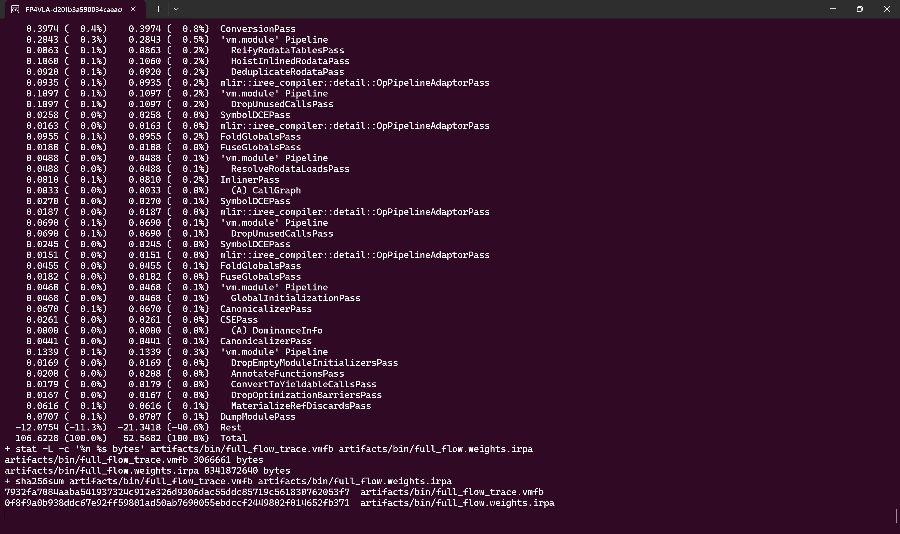

# IREE and `torch.compile` Backends for Embodied Flow Serving

This is an independent research project. It attaches IREE and
`torch.compile` backends to upstream embodied-model serving interfaces. Model
and runtime names are used only as technical identifiers needed for
reproduction. Backend packages provide execution only.


## 1. Backend interface and current status

`wall_x/serving/backend` provides a shared `generate_flow_action` interface and
a lazy registry:

| Backend name | Execution | Required artifacts |
|---|---|---|
| `eager` | Official Wall-X model path | None |
| `torch-compile` | Static prefill/suffix with Inductor, default `reduce-overhead` | None |
| `iree` | Torch context, staged IREE prefill/suffix, Host Euler | Two VMFB/IRPA pairs |
| `iree-expanded` | One `full_flow` graph containing ViT/context, prefill, K/V and nine suffix/Euler steps | One VMFB and one shared IRPA |

The registry rejects unknown names and missing artifacts. It does not infer
artifact paths from the Python installation and does not silently fall back to
eager. IREE compiler and runtime are stock upstream packages; model support
lives in this repository.

**Expanded status: experimental only.** The unified graph executes one `main`
per request with zero PyTorch vision/action-step calls. Final normalized and
physical actions pass the limited 2% checks. Independent context and V-cache
checks remain at 6.12648% and 10.65574%, above their 2% and 6% gates.

The current same-generate-call latency comparison also remains unfavorable to
expanded: `torch.compile` median 137.290 ms versus expanded 389.720 ms, a
252.430 ms difference and a 2.839× median ratio. Section 8 gives the complete
measurement protocol and the optimization work required to reduce that gap.

## 2. Validated Host and dependency configuration

| Component | Validated value |
|---|---|
| OS | WSL2 Ubuntu on Windows |
| GPU | NVIDIA GeForce RTX 5090 Laptop GPU, 24,463 MiB |
| Compute capability | `sm_120` / `(12, 0)` |
| Python | 3.12.14 |
| PyTorch | 2.10.0+cu130 |
| Transformers | 5.2.0 |
| CUDA toolkit for the Wall-X extension | 13.3 |
| NVCC Host compiler | `nvcc -ccbin clang-21` |
| IREE compiler / runtime | 3.13.0 / 3.13.0 |
| iree-turbine | 3.9.0 |
| flash-attn | 2.8.3 |
| NumPy | 2.2.6 |

The validated static profile is one request, two 448×448 images,
`pixel_values [2048,1176]`, 512 merged visual tokens, a 606-token prefix after
padding, 32 action tokens, 26 action dimensions, and ten inference steps.

For GPU safety on this WSL Host, do not use injected profilers (`nsys`, NCU or
compute-sanitizer). Check `free -g` before large model operations and run one
GPU job at a time. The provided spot benchmark limits warmup plus repetitions
to 20 per process.

## 3. Repository and environment setup

Clone the feature branch and enter it in WSL:

```bash
git clone -b feat/iree-serving-backend \
  https://github.com/zhaosiying12138/Wall-X-IREE-Backend.git
cd wall-x-iree
```

For an existing checkout:

```bash
git switch feat/iree-serving-backend
export PYTHONPATH="$PWD"
```

Construct the validated environment when `.venv-serve` is absent. Python 3.12,
CUDA 13.3, clang-21, `uv`, and the WSL NVIDIA driver are prerequisites.

```bash
uv venv --python 3.12 .venv-serve

uv pip install --python .venv-serve/bin/python \
  torch==2.10.0 torchvision==0.25.0 torchaudio==2.10.0 \
  --index-url https://download.pytorch.org/whl/cu130

uv pip install --python .venv-serve/bin/python -r requirements.txt
uv pip install --python .venv-serve/bin/python \
  numpy==2.2.6 numba==0.61.2 -r requirements-iree.txt

MAX_JOBS=4 uv pip install --python .venv-serve/bin/python \
  flash-attn==2.8.3 --no-build-isolation
```

Create the WSL CUDA loader link and build the Wall-X extension:

```bash
mkdir -p build/cudalib build/cuda-toolkit/bin
ln -sfn /usr/lib/wsl/lib/libcuda.so.1 build/cudalib/libcuda.so
for sub in include lib64 nvvm share; do
  ln -sfn "/usr/local/cuda-13.3/$sub" "build/cuda-toolkit/$sub"
done
cp tools/iree/nvcc_wrapper.sh build/cuda-toolkit/bin/nvcc
chmod +x build/cuda-toolkit/bin/nvcc
export LD_LIBRARY_PATH="$PWD/build/cudalib:${LD_LIBRARY_PATH:-}"
export CUDA_HOME="$PWD/build/cuda-toolkit"
export PATH="$PWD/build/cuda-toolkit/bin:$PATH"
export TORCH_CUDA_ARCH_LIST=12.0
.venv-serve/bin/python setup.py build_ext --inplace
```

`LD_LIBRARY_PATH` must be set before starting the Python process. The reference
`build/cuda-toolkit/bin/nvcc` uses `tools/iree/nvcc_wrapper.sh` to select
clang-21.

Run the CPU contracts:

```bash
CUDA_VISIBLE_DEVICES="" .venv-serve/bin/python \
  -m unittest -v tests.test_serving_backend
CUDA_VISIBLE_DEVICES="" .venv-serve/bin/python \
  tests/iree_wallx/test_expanded_static.py
```

The expected result is eight registry/Host-conversion tests and eight static
full-flow tests passing.


## 4. Checkpoint and frozen request bank

Set the checkpoint directory:

```bash
export WALLX_CKPT="$HOME/codebase/weights/wall-oss-0.5"
```

For a fresh download:

```bash
huggingface-cli download x-square-robot/wall-oss-0.5 \
  --local-dir "$WALLX_CKPT"
```

Verify the reference SHA-256 and generate the manifest and four-sample bank:

```bash
printf '%s  %s\n' \
  '37f8f327d3f9c27f056ed078db43c0e39b8caf3df0dc0163cdb8cf92c167968a' \
  "$WALLX_CKPT/model.safetensors" | sha256sum -c -
sha256sum "$WALLX_CKPT/model.safetensors" \
  > /tmp/wallx_checkpoint_sha256.txt
.venv-serve/bin/python tools/manifest/build_model_manifest.py \
  --checkpoint "$WALLX_CKPT" \
  --output artifacts/manifests/model.json \
  --model-hash-from /tmp/wallx_checkpoint_sha256.txt
.venv-serve/bin/python tools/manifest/build_bank.py \
  --checkpoint "$WALLX_CKPT" --samples 4
```

Native evidence:

- [Complete weight/bank console log](implementation_evidence/native_logs/weights.console.log)


The four `.pt` files are frozen inference fixtures, not training data or
model weights. `tools/manifest/build_bank.py` generates them with the official
model and `NOISE_SEED=20261023`. Each approximately 13 MB file contains raw
observations, preprocessed image patches, token/mask tensors, explicit noise,
full context, postfix tensors, per-layer KV digests, `v0`, the Flow trajectory,
and the final action. `index.json` records structural oracles and sample hashes.
The actual model weights remain in the separate IRPA.

| File | Sequence length | Purpose |
|---|---:|---|
| `sample_000.pt` | 638 | Full-flow export example, layer-by-layer comparison, and performance baseline |
| `sample_001.pt` | 638 | A different instruction under the same bucket |
| `sample_002.pt` | 633 | Short input requiring left-prefix padding |
| `sample_003.pt` | 641 | Over-bucket input requiring a new bucket or an explicit rejection |

These fixtures let eager, `torch.compile`, and IREE share the same initial noise
and metadata when comparing context, K/V, velocities, trajectories, and final
actions. The separate 635-token serving short-bucket test uses another input.
Regenerate the bank from the checkpoint when needed; `artifacts/` remains
untracked.


## 5. Export and compile the unified graph

Export production and diagnostic modules:

```bash
.venv-serve/bin/python tools/iree/export_full_flow.py \
  --vision-attn eager-bf16
.venv-serve/bin/python tools/iree/export_full_flow.py \
  --trace --skip-params --vision-attn eager-bf16
```


The production ABI has ten inputs: `input_ids`, `pixel_values`, `position_ids`,
`mask3d`, explicit `noise`, `padding_action`, official `times`, `postfix_pos`,
`suffix_mask`, and `dof_mask`. Production returns one normalized `[1,32,26]`
action. The separate trace ABI returns eight diagnostic tensors.

Compile production and trace with IREE's native diagnostics:

```bash
.venv-serve/bin/iree-compile artifacts/ir/full_flow.mlir \
  --iree-hal-target-device=cuda --iree-cuda-target=sm_120 \
  --dump-compilation-phases-to=/tmp/wallx_full_flow_phases \
  --iree-hal-dump-executable-configurations-to=/tmp/wallx_full_flow_hal \
  --mlir-timing --mlir-pass-statistics --mlir-print-ir-after-failure \
  -o artifacts/bin/full_flow.vmfb

.venv-serve/bin/iree-compile artifacts/ir/full_flow_trace.mlir \
  --iree-hal-target-device=cuda --iree-cuda-target=sm_120 \
  --dump-compilation-phases-to=/tmp/wallx_full_flow_trace_phases \
  --iree-hal-dump-executable-configurations-to=/tmp/wallx_full_flow_trace_hal \
  --mlir-timing --mlir-pass-statistics --mlir-print-ir-after-failure \
  -o artifacts/bin/full_flow_trace.vmfb
```




The production compiler log contains 24,697 lines of IREE-generated pass
statistics and timing. It is preserved in full rather than replaced by a custom
summary:

- [Production export log](implementation_evidence/native_logs/full_flow_export.console.log)
- [Production IREE compiler log](implementation_evidence/native_logs/full_flow_iree_compile.console.log)
- [Trace IREE compiler log](implementation_evidence/native_logs/full_flow_trace_iree_compile.console.log)
- [Production compiler terminal capture](implementation_evidence/native_iree_compile.png)
- [Current IR manifest and artifact hashes](implementation_evidence/ir/full_flow/manifest.json)

Current production artifacts are 15,608,302 B of MLIR, 3,057,029 B of VMFB,
and 8,341,872,640 B of shared IRPA.

## 6. Numerical and ABI verification

Configure the unified artifacts:

```bash
export WALLX_IREE_FULL_FLOW_VMFB="$PWD/artifacts/bin/full_flow.vmfb"
export WALLX_IREE_FULL_FLOW_IRPA="$PWD/artifacts/bin/full_flow.weights.irpa"
export WALLX_IREE_CUDALIB="$PWD/build/cudalib"
```

Run the checks:

```bash
.venv-serve/bin/python tests/iree_wallx/test_noise_injection.py
.venv-serve/bin/python tests/iree_wallx/verify_full_flow.py \
  --mode production --official-attn eager
.venv-serve/bin/python tests/iree_wallx/verify_full_flow.py \
  --mode trace --official-attn eager --fresh-official-flow \
  --allow-experimental --vmfb "$PWD/artifacts/bin/full_flow_trace.vmfb"
.venv-serve/bin/python tests/iree_wallx/verify_backend_short_bucket.py \
  --backend expanded
.venv-serve/bin/python tools/iree/compare_flow_traces.py \
  /tmp/wallx_full_flow_production.npz /tmp/wallx_full_flow_trace.npz
```

The production boundary reports `session_calls=1`,
`pytorch_vision_calls=0`, and `pytorch_action_step_calls=0`. Production and
trace final physical actions are bitwise identical.

| Check | Measured relmax | Gate / verdict |
|---|---:|---|
| Final normalized action vs fresh official | 1.2915% | PASS below 2% |
| Final physical action vs fresh official | 0.8330% | PASS below 2% |
| Final vs same-context static | 0.8088% | PASS below 2% |
| Context vs fresh official / Python static | 6.1265% | **FAIL above 2%** |
| Maximum V cache | 10.6557% | **FAIL above 6%** |
| Maximum K cache | 3.6651% | PASS below 6% |
| Maximum velocity | 0.7882% | PASS below 2% |
| `v0` / `x0` | <0.24% | PASS |

The verifier prints the actual separate verdicts:

```text
RESULT: FAIL
STRICT_RESULT: FAIL
EXPERIMENTAL_RESULT: PASS
```

Native evidence:

- [Complete full-flow verification log](implementation_evidence/native_logs/full_flow_verify.console.log)
- [Complete staged IREE regression log](implementation_evidence/native_logs/staged_verify.console.log)


The expanded 635→638 short-bucket check reports 1.17349% final physical-action
relmax. This covers one frozen short input.

## 7. Official WebSocket serving and complete response logging

Start the expanded backend through the official launcher:

```bash
export WALLX_CKPT="$HOME/codebase/weights/wall-oss-0.5"
export WALLX_IREE_FULL_FLOW_VMFB="$PWD/artifacts/bin/full_flow.vmfb"
export WALLX_IREE_FULL_FLOW_IRPA="$PWD/artifacts/bin/full_flow.weights.irpa"
export WALLX_IREE_CUDALIB="$PWD/build/cudalib"
export PYTHON_BIN="$PWD/.venv-serve/bin/python"
export SERVER_LOG=/tmp/wallx_expanded_server.log
export WS_PRINT_RESPONSE=1
bash scripts/iree_serving.sh expanded_serve
```

The script tees native server stdout/stderr to the console and `SERVER_LOG`.
The log contains the actual activation line:

```text
serving backend ACTIVE (name=iree-expanded; no implicit fallback)
```

`WS_PRINT_RESPONSE=1` makes the client print the complete decoded response,
including every value in the `[1,32,26]` physical action array and
`server_timing`. These values are produced by the actual model response. They
are not hand-written coordinates, and the 26 action dimensions are not all
Cartesian coordinates.

- [Complete server and decoded-response log](implementation_evidence/native_logs/expanded_serving.console.log)
- [Server-only log](implementation_evidence/native_logs/expanded_server_only.console.log)


The first request in this capture reports `infer_ms=8061.880`, which includes
session initialization. It is not a steady-state latency result.

For staged serving, use `bash scripts/iree_serving.sh serve` with
`WALLX_IREE_PREFILL_VMFB`, `WALLX_IREE_PREFILL_IRPA`,
`WALLX_IREE_STEP_VMFB`, and `WALLX_IREE_STEP_IRPA` configured. For the
`torch.compile` peer, use `bash scripts/iree_serving.sh torch_compile_serve`;
`WALLX_TORCH_COMPILE_MODE=default` selects default Inductor instead of
`reduce-overhead`.

## 8. Matched backend comparison

### 8.1 Same generate-call protocol

`tests/iree_wallx/spot_backend_latency.py` supports `official`, `staged`,
`expanded`, and `torch-compile`. Run each backend in a separate process with
three warmups and ten timed calls. The second round reverses backend order.
Each result JSON and final physical-action array is saved for independent
analysis.

```bash
.venv-serve/bin/python tests/iree_wallx/spot_backend_latency.py \
  --backend official --warmup 3 --repetitions 10 \
  --out /tmp/r1_official.json --array-out /tmp/r1_official.npz

.venv-serve/bin/python tests/iree_wallx/spot_backend_latency.py \
  --backend torch-compile --warmup 3 --repetitions 10 \
  --torch-compile-mode reduce-overhead \
  --out /tmp/r1_torch_compile.json --array-out /tmp/r1_torch_compile.npz

.venv-serve/bin/python tests/iree_wallx/spot_backend_latency.py \
  --backend staged --warmup 3 --repetitions 10 \
  --prefill-vmfb $PWD/artifacts/bin/joint_prefill.vmfb \
  --prefill-irpa $PWD/artifacts/bin/joint_prefill.weights.irpa \
  --step-vmfb $PWD/artifacts/bin/denoise_step.vmfb \
  --step-irpa $PWD/artifacts/bin/denoise_step.weights.irpa \
  --out /tmp/r1_staged.json --array-out /tmp/r1_staged.npz

.venv-serve/bin/python tests/iree_wallx/spot_backend_latency.py \
  --backend expanded --warmup 3 --repetitions 10 \
  --expanded-vmfb "$WALLX_IREE_FULL_FLOW_VMFB" \
  --expanded-irpa "$WALLX_IREE_FULL_FLOW_IRPA" \
  --out /tmp/r1_expanded.json --array-out /tmp/r1_expanded.npz
```

Build the staged artifacts before running the staged benchmark:

```bash
.venv-serve/bin/python tools/iree/export_joint_prefill.py --attn fp16
.venv-serve/bin/python tools/iree/export_denoise_step.py
.venv-serve/bin/iree-compile artifacts/ir/joint_prefill.mlir   --iree-hal-target-device=cuda --iree-cuda-target=sm_120   -o artifacts/bin/joint_prefill.vmfb
.venv-serve/bin/iree-compile artifacts/ir/denoise_step.mlir   --iree-hal-target-device=cuda --iree-cuda-target=sm_120   -o artifacts/bin/denoise_step.vmfb
```

The timed region includes context, Flow and official finalization while
excluding session creation and the final Host NumPy conversion. ViT attention
profiles differ, so this is a deployment-configuration comparison rather than
a compiler-only A/B.

### 8.2 Current results

| Backend | Samples | Median | Mean | p95 |
|---|---:|---:|---:|---:|
| Official eager | 20 | 578.051 ms | 601.468 ms | 766.026 ms |
| `torch.compile` | 20 | **137.290 ms** | 137.502 ms | 140.166 ms |
| Staged IREE | 20 | 395.439 ms | 395.136 ms | 409.280 ms |
| Expanded IREE | 20 | 389.720 ms | 392.184 ms | 401.212 ms |

Expanded is 252.430 ms slower than `torch.compile` by median, a 2.839× ratio.
Latency parity has not been achieved. The small expanded/staged difference does
not change that conclusion.

Final physical-action relmax against the same-round official output is 1.0730%
for `torch.compile`, 0.9968% for staged, and 0.6640% for expanded. All three
pass the limited 2% final-action gate. Expanded's independent context and
V-cache failures remain separate.

Evidence:

- [Complete backend comparison console log](implementation_evidence/native_logs/backend_compare.console.log)
- [Per-run JSON and action arrays](implementation_evidence/native_logs/results/)
- [Computed comparison statistics](implementation_evidence/native_backend_comparison.json)
- [Log, result, and screenshot hashes](implementation_evidence/native_logs/manifest.json)


### 8.3 Solver-only B3/B4 reference

The retained solver-only baseline excludes ViT/context, finalization and Host
output:

| Backend | Samples | p50 | Mean |
|---|---:|---:|---:|
| Static eager solver | 15 | 345.1 ms | 344.9 ms |
| B4 default `torch.compile` | 15 | 115.1 ms | 115.6 ms |
| B3 `torch.compile(mode="reduce-overhead")` | 15 | **87.5 ms** | 87.4 ms |
| B3 formal P8 | 5000 | **88.88 ms** | 88.98 ms |

These values use a different boundary from the 389.720 ms expanded
generate-call result. They must not be divided by that result to form a
headline ratio. Raw references are preserved in
[`b3_b4_baselines.json`](implementation_evidence/native_logs/b3_b4_baselines.json)
and [`p8_b3_summary.json`](implementation_evidence/native_logs/p8_b3_summary.json).

### 8.4 Work required to approach parity

1. Resolve the independent context and V-cache numerical failures before
   treating expanded as a strict replacement.
2. Measure a phase budget for ViT/context, prefill, suffix/Euler, metadata,
   Host transfers and finalization. The 252.430 ms gap needs measured causes.
3. Remove GPU→NumPy→IREE input round-trips, prebind static buffers, retain the
   final action on Device, and cache metadata where semantics permit.
4. Optimize the static ViT's 64-token windows and 1024-token full-attention
   segments while preserving eager-BF16 rounding order.
5. Compare Inductor and IREE fusion/memory behavior for GQA, masks, RoPE,
   normalization, casts, residuals and Euler updates.
6. Add a full-tensor-graph B3/B4 comparison with the same ten-input ABI and a
   solver-only comparison matching the retained B3/B4 boundary. Report cold
   start, steady state, numerical error and artifact hashes separately.

## 9. Adding another embodied model or embodiment

Follow the backend layers rather than adding model-specific branches to the
WebSocket wrapper:

1. Freeze the model contract: observation schema, action horizon/dimension,
   expert routing, cache, Flow schedule, normalization and embodiment metadata.
2. Express traceable computation in `wall_x/serving/backend/static_flow`.
   Preserve explicit state and static shapes.


3. Add a thin export CLI and define the deployment/diagnostic interface and external
   parameters.
4. Add model adaptation to `wall_x/serving/backend/iree` or the relevant peer
   backend. Extend the registry only when a new backend name is required.
5. Configure artifacts explicitly and validate capabilities such as camera
   grids, batch, action horizon, DOF and sequence bucket.


6. Add same-noise numerical checks, production/trace checks, real serving,
   complete response logging, and a same-boundary `torch.compile` comparison.
7. Preserve native compiler, runtime, numerical and performance logs with the
   change. IREE upstream remains unmodified.

The implementation history is organized into cohesive commits covering the
backend interface and `torch.compile`, staged IREE, unified full-flow support,
and validation/documentation. These layers indicate the files that a new model
integration is expected to touch.
