# 为具身 Flow/VLA 模型接入 IREE 后端：从模型契约到整图编译

*以 Wall-OSS-0.5 为例，拆解条件上下文、MoT 共享注意力、Flow 动作生成、静态 shape 与设备 ABI*

> 先说清楚支持一个新模型时到底要改什么。**IREE 源码和 pass 均保持上游版本，我们只在 Wall-X 内增加模型支持和后端接入。** IREE 是现成的第三方编译与运行后端，我们承担的是模型适配和 上游 serving 接入工作。一次典型接入分成四层：
>
> 1. **用 PyTorch 写出可导出的计算图。** 保留官方模型的算子顺序和数值语义，把动态 shape、隐式 cache、Host 控制流改成显式 tensor、静态切片和静态循环。这里写的是描述计算图的 `nn.Module`，CUDA kernel 由 IREE 或 Inductor 在后续编译中生成。
> 2. **定义部署接口并导出。** 用 Turbine/torch-mlir 得到 Torch-level IR，把权重外置为 IRPA，固定输入 shape、输出 shape、noise、mask、时间网格和诊断入口。
> 3. **交给官方 IREE 编译和执行。** `iree-compile` 的既有 pass 完成 linalg、Flow dispatch、Stream、HAL 和 VM lowering，`iree.runtime` 加载 VMFB/IRPA。我们使用这些标准能力，编译器本身保持原样。
> 4. **接入 Wall-X serving 并验证。** backend 负责模型专属预处理、artifact 配置、能力检查和官方 finalizer，随后做同 noise 数值对拍、真实 serving、动作响应和 `torch.compile` 同边界对照。
>
> 因此，新增模型时的主要工作量集中在**模型语义、shape/state、数值验证和 serving 集成**。遇到超出 Dynamo trace 能力的自定义 CUDA op 或动态路由时，我们用等价的可 trace 运算表达，或者把明确属于 Host 的工作留在接口外。
>
> 这篇文章从一次真实动作请求讲起：Wall-X serving 收到两路图像、一条指令和机器人状态后，先形成 606 个视觉/文本/状态 prefix token，再接入 32 个 action token。模型从 `[1,32,26]` 的高斯噪声出发，经过一次 joint prefill 和 9 次 suffix/Euler，最终返回 32 个未来动作位置。我们把这段可张量化主链编译为一个 `full_flow.vmfb`，JPEG 解码、tokenizer、动态 mask 和最终反归一化仍由官方 Host 侧代码完成。
>
> 阅读时只需抓住三条线。**第一条是张量怎样流动**：606/638 双段序列、36 层双 expert、K/V、DOF mask 和时间网格如何进入部署接口（deployment ABI）。**第二条是 IREE 怎样接管计算**：Torch-level IR 如何经过 input conversion、linalg、Flow dispatch、Stream、HAL 和 VM 变成 CUDA 可执行模块。**第三条是 Wall-X 怎样选择后端**：同一 serving 接口下，eager、`torch.compile` 和 IREE 如何分别执行并比较。
>
> 每章都配当前分支的核心源码和实际执行记录。你会看到 `iree-compile` 自己输出的 pass statistics 和 timing、真实 `iree-expanded` 后端激活、关键动作响应，以及同 generate-call 下 `torch.compile` 137.290 ms 对 expanded 389.720 ms 的差距。严格数值结论也直接写出：最终动作通过有限门槛，context 和 V-cache 的严格结果为 FAIL，expanded 当前是 experimental-only。其他具身 Flow/VLA 可以复用这套接入顺序，具体 shape、路由、mask 和动作语义则必须从各自 checkpoint 重新确认。
>
> 模型背景引用 [WALL-OSS，arXiv:2509.11766](https://arxiv.org/pdf/2509.11766) 与 [Wall-OSS-0.5，arXiv:2605.30877v2](https://arxiv.org/pdf/2605.30877v2)，页码为 PDF 页序。文中 serving 检查只看 WebSocket 返回的动作形状和有限数值，数值对拍另列与官方实现的误差，性能测试另列各后端耗时；机器人任务成功率需要独立的任务评测。当前 `iree-expanded` 的验收状态以后文真实日志为准。

**全文按四部分阅读：**

| 部分 | 章节 | 要回答的问题 |
|---|---|---|
| 模型与接口 | 第 1–3 章 | 一次动作请求包含哪些计算？H/D、MoT、K/V、DOF 和时间网格怎样决定部署接口？ |
| 整图与编译 | 第 4–5 章 | Python 静态模块怎样变成 MLIR？IREE 的 input conversion、dispatch、Stream、HAL、VM 各做什么？ |
| 后端与原生证据 | 第 6–9 章 | eager、`torch.compile` 和 IREE 怎样挂到同一 Wall-X serving？真实编译、动作响应和数值验收长什么样？ |
| 性能与扩展 | 第 10–11 章 | expanded 与 `torch.compile` 差多少、差距来自哪些待测环节？新增模型或 embodiment 应按什么顺序修改？ |

## 一、接入 IREE 的起点：定义模型契约与整图边界

### 1.1 具身 Flow/VLA 后端需要接管哪些计算

许多具身 VLA 可以拆成两个逻辑阶段。第一阶段把相机图像、语言指令、机器人状态和 embodiment 配置编码为条件上下文 $c$；第二阶段从噪声动作块出发，在条件 $c$ 上反复评估速度场，得到连续动作序列：

$$
c=E(\text{images},\text{instruction},\text{state},\text{embodiment}),
\qquad
v_j=v_\theta(z_j,t_j,c),
\qquad
z_{j+1}=\mathcal S(z_j,v_j,t_j,t_{j+1}).
$$

这里的 $E$ 可以包含 ViT、文本/状态嵌入和多层 Transformer，$\mathcal S$ 表示具体的 Flow solver 更新。IREE 后端接入工作要回答：哪些部分进入同一张设备计算图，哪些状态在图内复用，哪些输入由Host 侧准备，最终动作在哪一种表示下跨出 ABI。

编译器需要一份可检查的契约，至少分成四层：

| 契约层 | 需要明确的内容 | 对 IREE 接入的影响 |
|---|---|---|
| 模型语义 | 条件输入、动作 horizon、动作维度、专家可见性、连续输出含义 | 决定计算是否与原模型等价 |
| 张量图 | shape、dtype、路由边界、mask、时间网格、K/V 与动作状态的生命周期 | 决定能否 trace、静态化和 lowering |
| 部署接口 | 显式输入、外置权重、返回值、生产与诊断入口 | 决定 runtime 如何加载和调用 VMFB |
| Host 侧/serving | 图像解码、tokenizer、动态 metadata、反归一化、协议和机器人配置 | 决定官方 wrapper 怎样无歧义地衔接设备图 |

这份分层也给出验证顺序：先确认语义，再核对张量与状态，随后检查设备调用，最后测量 serving 和性能。只看到一次 `main` 返回有限数值，尚不足以证明每一层契约都已满足。

### 1.2 后端无关的七个接入问题

面对一个新的具身 Flow/VLA 模型，可以先固定以下答案：

1. **输出怎样构成动作块。** 用 $H$ 表示 action horizon，用 $D$ 表示每个动作位置的特征维度，典型输出为 `[B,H,D]`。$H$ 与 $D$ 分别进入 noise、mask、投影和输出 ABI。
2. **条件怎样进入图。** 图像可能已是 patch tensor，文本和 proprioception 可能已变成 token，position 与 attention mask 也可能由Host 侧构造。每种表示都有对应的输入边界。
3. **专家怎样路由并交换信息。** token-type 路由、top-k 路由、共享 attention、独立 cross-attention 会产生不同的张量拼接、权重布局和 mask。
4. **哪些状态能够复用。** 一次请求内不变的 prefix K/V 可以缓存；随 Flow 时间变化的动作 hidden、当前 K/V 和 solver 状态需要重算或显式传递。
5. **推理采用什么时间语义。** Flow 进度、动作序列的机器人时间和设备 wall time 属于不同坐标，分别影响 solver schedule、控制配置和性能测量。
6. **哪些训练组件可以留在部署图之外。** 连续动作部署接口只包含推理所需的状态和算子。
7. **哪些维度需要静态特化。** batch、图像网格、prefix 长度、action horizon、层数和时间步数可以成为编译 profile；可变输入通过 padding、bucket 或独立导出处理。

这些答案最终都会体现在 ABI 中。动作维度决定 `[H,D]` 张量，确定性专家路由决定分段边界，共享 attention 决定联合 Q/K/V 与可见性矩阵，Flow solver 决定时间数组和循环状态，Host 侧预处理与后处理决定还需要保留哪些官方 wrapper 逻辑。

### 1.3 Wall-OSS-0.5 案例的整图边界

当前案例把可张量化的模型主链放进 `StaticFullFlow`：视觉塔、文本/图像/状态嵌入、t=0 action embedding、36 层双 expert Transformer、首次速度评估、prefix K/V、后续 9 次速度评估和 Euler 更新位于同一个 `main`。生产入口返回最终归一化动作；诊断入口另行导出中间 context、K/V、速度与轨迹。

JPEG 解码、图像 resize/normalization、tokenizer、state-string 离散化、动态 position/mask 准备、最终反归一化、msgpack 与 WebSocket 仍由Host 侧承担。生产形态使用一个 `full_flow.vmfb` 和匹配的 `full_flow.weights.irpa`，每次请求调用一次 `main`。后文将逐层检查这条边界，下面先解释它依赖的模型语义。

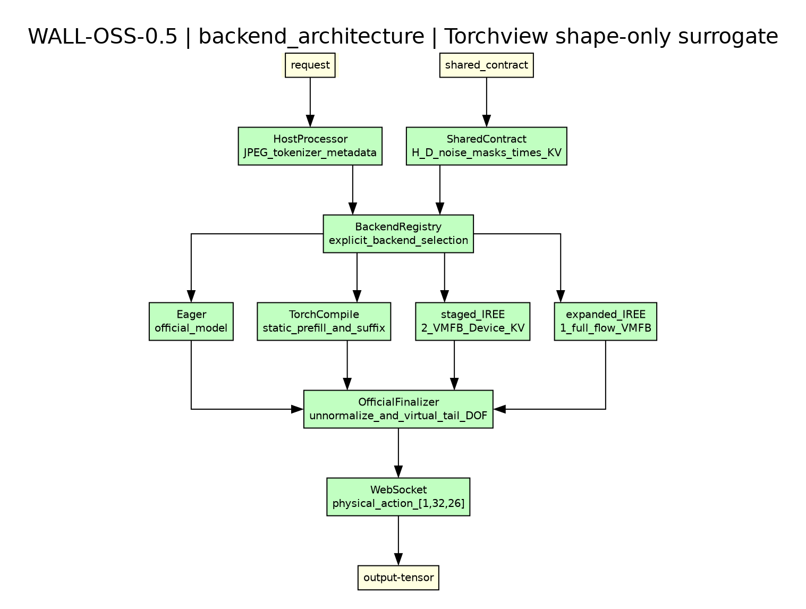

serving 层通过同一个 backend registry 选择官方 eager、`torch.compile` 或 IREE。模型支持、artifact 配置和数值验收由各后端包承担，官方 wrapper 继续提供统一的观测、协议与动作接口。

## 二、具身 Flow/VLA 的背景：动作块、训练接口与两种时间

### 2.1 Action horizon 与 action dimension 回答不同问题

动作块可以写为 $Z\in\mathbb R^{B\times H\times D}$：

- $H$ 是 **action horizon**，表示一次预测包含多少个未来动作位置；
- $D$ 是 **action dimension**，表示每个动作位置需要多少个数值来描述；
- $B$ 是 batch size，与机器人时间无关。

Wall-OSS-0.5 的论文接口预测一秒动作 horizon，帧数随数据源控制频率调整（§2.2.3，p.7）。当前导出案例实例化为 $B=1,H=32,D=26$，所以 noise、网络速度和最终归一化动作都使用 `[1,32,26]`。这里的 32 描述动作序列长度，26 描述每个位置的表达能力；Flow solver 的评估次数由 `num_inference_timesteps` 和 `times` 单独决定。

机器人执行动作块时还需要控制频率、插值和重规划策略。Flow 求解则在另一条时间轴上工作：一次动作请求可以从噪声开始，经过若干次网络评估生成全部 32 个位置。每个 Flow 时间点同时作用于整个 `[32,26]` 动作块，并不依次对应某一个机器人动作帧。

### 2.2 离散 RVQ/FAST 与连续 Flow 承担不同阶段的职责

VLA 常用离散动作 token 接入语言模型的自回归训练接口。FAST 提供规则驱动的动作压缩；Wall-OSS-0.5 改用学习得到的 Vision-Aligned RVQ Action Tokenizer，在 observation-conditioned delta action 上执行 Encoder–RVQ–Decoder 训练，并加入视觉—动作对齐、下一帧预测和 DCT 域重建目标（§2.1.2，p.5）。

在 Wall-OSS-0.5 的 gradient-bridged co-training 中：

- action-token cross-entropy 预测 RVQ token，为 VLM backbone 提供动作相关的训练梯度；
- multimodal cross-entropy 维持指令、视觉定位与具身场景理解；
- flow matching 训练连续 Action Expert，供部署时生成动作块（§2.2.1，p.5–6）。

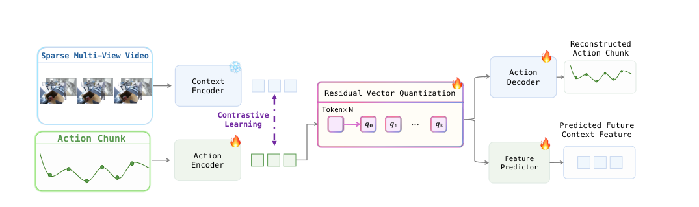

这张图对应的是**训练时的动作表示学习**：视频和动作块分别编码，经 RVQ 得到离散 token，再训练动作重建和未来特征预测。当前 `full_flow` 只导出下方的连续 Flow Action Expert。

默认动作推理沿连续 Flow 路径解码，离散动作 token 用于训练接口（§2.2.1，p.6；§2.2.3，p.7）。因此，通用动作后端可以把 RVQ 码本、AR 解码、CE 和真值动作留在训练侧；生产图重点保留条件编码、连续动作投影、共享 Transformer、速度输出和 solver。若某个产品同时提供离散动作或文本生成入口，应把它作为独立模型契约和独立导出处理。

### 2.3 训练损失与推理计算分别定义接口

Flow Matching 的训练插值可以写成：

$$
z_t=(1-t)z_0+t\,a,
\qquad
v_{\text{target}}=a-z_0,
$$

其中 $a$ 是真实动作，$z_0$ 是噪声。网络接收 $z_t,t,c$，学习速度场 $v_\theta(z_t,t,c)$。真实动作只在训练时提供；部署从显式或随机生成的 $z_0$ 出发，反复评估 $v_\theta$ 并更新状态。

Wall-OSS-0.5 的联合损失为

$$
\mathcal L=\mathcal L_{\text{flow}}
+0.01\mathcal L_{\text{act-CE}}
+0.01\mathcal L_{\text{mm-CE}}
$$

（§2.2.1，p.6，式(1)）。Action-Space Supervision 保留网络的速度预测，同时在恢复动作上计算损失，并等价于速度损失的 $(1-t)^2$ 加权（§2.2.2，p.6，式(2)–(6)）。这些公式解释训练怎样塑造网络，部署接口只接收推理所需 tensor。

当前案例的 `use_x_pred=False`，`action_proj_back` 的输出直接作为速度进入 Euler 更新。训练时采用 action-space loss，运行时仍由 `action_proj_back` 直接输出速度；IREE 对拍继续逐层比较速度、状态和最终动作。

2025 年 WALL-OSS 论文在 Integration Stage 使用 $x_t=(1-\rho)x_0+\rho\epsilon$ 与目标 $\epsilon-x_0$，即从干净动作走向噪声的 $\rho$ 坐标。当前部署采用从噪声走向动作的 $t$ 坐标。令 $t=1-\rho$，速度符号随之反转，两种写法描述同一条概率路径。后端以实际代码的时间方向为准，Euler 输入使用代码中的 $t$ 网格。

### 2.4 Flow 时间、机器人时间与设备耗时

Flow 时间 $t$ 是从噪声到动作的归一化进度坐标。若使用 Euler solver，状态更新为

$$
z_{j+1}=z_j+(t_{j+1}-t_j)v_\theta(z_j,t_j,c).
$$

当前案例配置 `num_inference_timesteps=10`，`get_inference_times` 产生 11 个时间点，形成 10 次速度评估和 10 次状态更新：prefill 完成第 1 次，suffix 完成后 9 次。动作状态记为 $z_0,z_1,\ldots,z_{10}$，每次更新都处理完整的 `[1,32,26]`。

`time_shift` 调整评估位置，`s` 对时间网格做整体缩放。本案例 `time_shift=1.0`、`s=0.999`，所以原始 `linspace(0,1,11)` 被缩放为 `0,0.0999,…,0.999`。训练使用的 `beta_alpha=1.5`、`beta_beta=1.0` 控制随机时间采样；推理使用固定网格，二者分别描述训练采样与部署 schedule。

这里有三套需要分别写入文档和代码的时间概念：

| 概念 | 在本案例中的体现 | 对后端的作用 |
|---|---|---|
| Flow 进度 | 11 个 t_j、10 个 solver 区间 | 决定 `times[11]`、每步 timestep 与 `dt` |
| 机器人动作时间 | 32 个动作位置；论文接口为一秒 horizon，帧率随数据源配置 | 决定动作块语义、执行和重规划配置 |
| 设备 wall time | context、prefill、suffix、Host finalizer 与协议耗时 | 仅用于性能测量 |

Flow 评估次数由 solver schedule 决定，与 action horizon 和设备耗时分别定义；$t_j$ 来自时间网格。

### 2.5 $\pi_0$、$\pi_{0.5}$ 与 Wall-OSS-0.5 的边界

这些模型共享 Flow/VLA 的若干设计元素，各自契约仍需单独核对：

- Wall-OSS-0.5 的高噪声训练时间采样明确跟随 $\pi_0$：Beta 采样后经过 $1-u$ 与尺度缩放（§2.2.2，p.6，式(3)）。这是训练 schedule 的方法联系。
- $\pi_{0.5}$ 共同训练 FAST-based 自回归路径和 flow-matching 路径。Wall-OSS-0.5 使用 Vision-Aligned RVQ，把离散路径作为 gradient bridge，并加入 Action-Space Supervision（§6，p.21）。
- 报告还将 Wall-OSS-0.5 的端到端梯度与 $\pi_{0.5}$ 的 stop-gradient 设计对照（§2.2.1，p.5–6）。这个差异影响训练图，部署 ABI 应以各自实际 inference graph 为准。
- Wall-OSS-0.5 从 Qwen2.5-VL-3B-Instruct 初始化并扩展 MoT（§2.1.1，p.4），名称中的“0.5”只是版本标识，权重、shape 和 serving ABI 由各自 checkpoint 与官方实现决定。
- 2025 年 WALL-OSS 以 FAST 离散动作先验、Flow Head 和 Uni-CoT 组织训练；2026 年 Wall-OSS-0.5 改用 Vision-Aligned RVQ，并明确把离散路径作为 gradient bridge，目标是直接得到部署可用的预训练策略。两代模型的训练接口发生变化，连续 Flow 推理所要求的显式状态与动作 ABI 仍可按同一方法分析。
- 旧论文同时指出 $\pi_0$ 在部分精细操作上更强（WALL-OSS §6.1，p.14）。这些比较用于理解模型结构和计算语义，不构成“某一代模型全面优于另一系列”的依据。

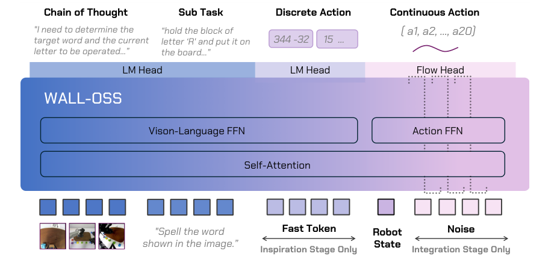

这张原图帮助区分两代训练接口：2025 年的离散侧是 FAST token，2026 年则换成前面的 Vision-Aligned RVQ。两侧共享 attention 的基本思想延续下来，当前 IREE 案例只取连续 Flow 推理路径。

对通用 IREE 后端而言，可复用的是条件编码、显式状态和迭代求解的接入方法；模型专属 tokenizer、路由边界、action schema 与 solver 配置必须来自各自 checkpoint 和官方实现。

## 三、Wall-OSS-0.5 案例：把 MoT 与动作语义落成真实 ABI


### 3.1 MoT：两路 Expert 怎样在一条 638 行序列里协同工作

先只看一条输入序列，不谈公式。VL 是 vision-language 的缩写。当前 638 个 token 按来源分成两段：

| 序列位置 | token 内容 | 进入哪个 Expert |
|---|---|---|
| `[0,512)` | 两路图像产生的 512 个视觉 token | VL Expert |
| `[512,606)` | 指令、特殊标记和离散化状态，共 94 个 | VL Expert |
| `[606,638)` | 当前带噪连续动作，共 32 个 | Action Expert |

因此，`moe_token_types = [False × 606, True × 32]` 可以直接读成一张分流表：

```text
token_index < 606  → VL Expert
token_index >= 606 → Action Expert
```

路由在输入阶段已经写好，前向计算按这张表选择 Expert。后文所说的**确定性 expert routing**就是这个意思。短输入在左侧 padding 后，路由表、起止索引、position 和 mask 必须一起移动，右侧 32 个 action 始终保持在 `[606,638)`。

**第一步：两路分别做 norm 和 QKV 投影。**

每层 Transformer 先对两段分别做归一化，再分别乘各自的 QKV 权重。Q/K/V 是 query、key、value，O 是 attention 之后的输出投影，MLP 是每个 Expert 自己的前馈网络。

- VL 段输入宽度为 2048，VL Expert 的 fused QKV 输出为 2560。
- Action 段输入宽度为 1024，Action Expert 的 fused QKV 输出同样为 2560。
- 2560 都拆成 `2048 + 256 + 256`，对应 Q、K、V。于是两路都能形成 16 个 128 维 Q head 和 2 个 128 维 KV head。

两路参数各自独立，head 几何则一致。Action Expert 的 hidden 为 1024，head_dim 始终为 128。

**第二步：把 Q/K/V 拼回 638 行，做一次 joint attention。**

两路 Q/K/V 按原来的序列顺序拼接，恢复 `[VL prefix | current action]` 的 638 行布局，然后执行带 mask 的 joint attention。这里共享的是注意力计算和跨段信息交换，QKV/O/MLP 的权重仍然分属两路。

用一个 action query 就能看出 mask 的作用。当前 `causal_action_attention_mask=true`：

- 第 0 个 action query 可以看到 606 个 prefix key 和自身，共 607 个 key；
- 第 5 个 action query 可以看到 606 个 prefix key 和前 6 个当前 action key，共 612 个 key。

这样，当前连续动作可以读取图像、指令和机器人状态。离散动作与连续动作之间的可见规则由 mask 逐行确定。

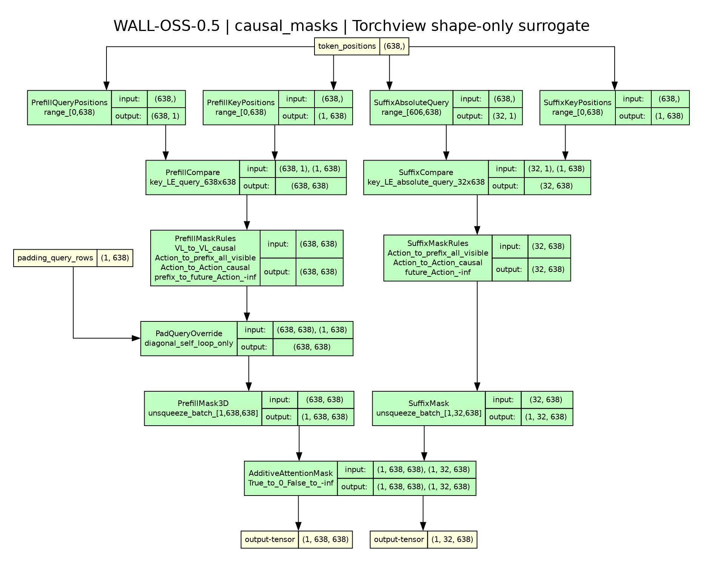

Q/K/V 都来自同一条拼接序列，因此这里的计算形式是 **joint self-attention**，与 encoder-decoder cross-attention 的独立上下文来源不同。当前 mask 由 `tril` 生成：VL prefix query 也只能读取历史 prefix，prefix 到未来 action 的区域被遮蔽。suffix 的 32 个 action query 对 638 个 key 计算时，606 个 prefix key 全部可见，当前 action 仍按 causal 下三角可见。prefill 使用 fp16-score math attention，suffix 的 `online_attention` 是实现方式，二者沿用同一份 mask 语义。

**第三步：按原分段恢复 O、MLP 和 residual。**

attention 结束后，计算结果再次按 `[0,606)` 和 `[606,638)` 切开，分别进入两路 O 投影、MLP 和 residual。Action Expert 的输出宽度为 1024，而 joint residual 需要 2048 宽布局，所以后 1024 个 hidden 通道补零，形成 zero corridor。这个补零只负责网络通道对齐，与某个动作 DOF 是否有效无关。

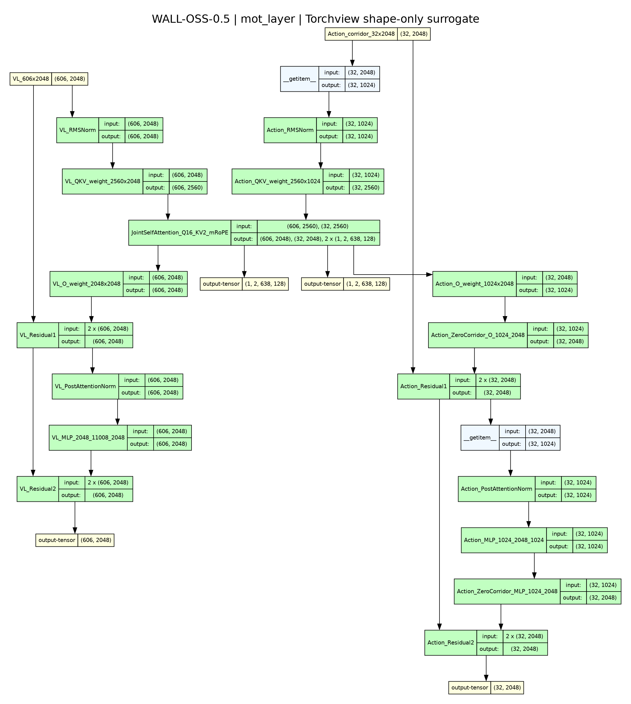

读图顺序为：顶部三段 token → 左右两路独立 norm/QKV → 中央 joint self-attention → 两侧独立 O/MLP/residual。图中每个权重形状都对应当前 checkpoint；中央注意力共享 head 几何与可见性，两侧 FFN 保留各自参数。

一次请求内，视觉、指令和状态保持不变，prefill 只需为 prefix 计算一次 K/V。进入下一个 Flow 时间点后，当前动作 $z_j$ 已改变，32 个 action token 的 embedding、Q/K/V 和 hidden 必须重新计算；拼接时复用的仍是前面的 606 行 prefix K/V。当前 ABI 中，36 层堆叠后的 K 或 V 为 `[36,1,2,638,128]`，prefix K 已应用 mRoPE，V 不旋转。

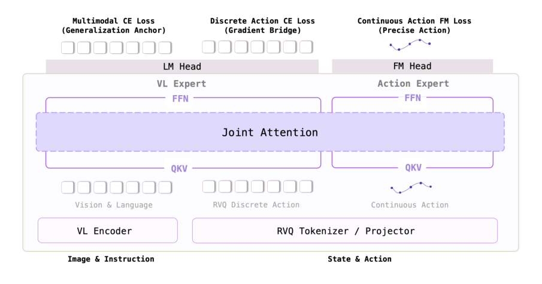

把论文图与上面的三步对应起来：图中的两个 FFN 是两路独立参数，贯穿两者的 Joint Attention 是信息交换位置，顶部的三项 loss 属于训练阶段。当前 IREE 部署接口只需要连续 Flow 推理路径，生产图只包含连续 Flow 推理路径。

当前 checkpoint 的主干尺寸可以压缩成下表：

| 项目 | 当前值 | 对编译的直接影响 |
|---|---|---|
| 主层数 / joint hidden | 36 / 2048 | 决定层展开与 residual 布局 |
| VL Expert hidden / MLP | 2048 / 11008 | 处理视觉、文本和状态 prefix |
| Action Expert hidden / MLP | 1024 / 2048 | 处理 Flow action token |
| Attention heads | 16 Q / 2 KV / head_dim 128 | 两路 QKV 可以按统一几何拼接 |
| Action causal mask | query i 可见 prefix 与前 i+1 个当前 action | 决定 prefill 与 suffix mask |

这份结构直接决定 MLIR 中的切片、拼接和 mask：编译器必须保留 606/32 的 Expert 分段、统一 head 几何、Action causal 可见性以及 prefix K/V 的生命周期。下一节再把 606 和 638 的来源逐项展开。

### 3.2 512 + 94 = 606，606 + 32 = 638

当前 bank 使用两路 `448×448×3` 图像。checkpoint 的 `patch_size=14`、`spatial_merge_size=2`，所以每路图像先有

$$
(448/14)^2=1024
$$

个 patch，再经 2×2 spatial merge 形成 $1024/4=256$ 个 joint 视觉 token。两路合计 512 个视觉 token。加上当前指令、特殊标记与离散化状态所占的 94 个 token，得到本案例的 prefix：

```text
512 个视觉 token
+ 94 个文本、特殊标记和离散化状态 token
= 606 个 prefix token
+ 32 个连续 Flow action token
= 638 个 joint sequence token
```

也就是 **512 + 94 = 606，606 + 32 = 638**。`[0,606)` 进入 VL Expert，`[606,638)` 进入 Action Expert。视觉、文本和 t=0 action embedding 合成后的 `inputs_embeds` 为 `[1,638,2048]`。

606 和 638 属于这个图像网格、指令、状态表示与 action horizon 共同确定的静态 bucket；其他配置使用各自对应的 bucket。较短输入可以在 prefix 左侧 padding，同时保持 action 位于右端；不同图像网格、超过桶长的文本或其他 horizon 需要相应 bucket 和独立数值验收。

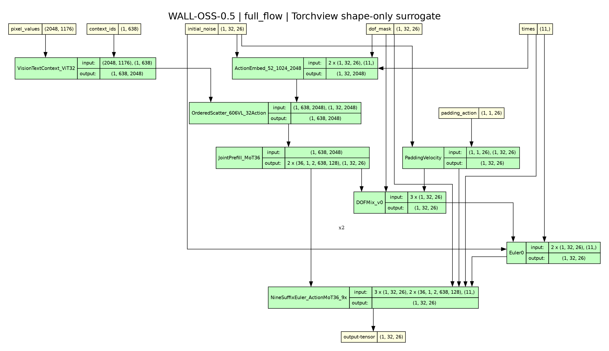

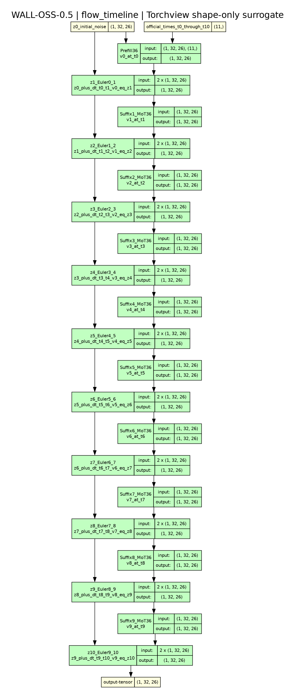

图中保留了本案例的视觉 token 计算、双段 expert 路由、整图边界与 $z_0\rightarrow z_{10}$ 状态链。时间轴进一步展开 prefill 的 `v_0` 与第一次 Euler 更新，以及随后 9 个 suffix/Euler；每个 `z_(j+1)` 都由当前 `z_j`、速度 `v_j` 和步长 `t_(j+1)-t_j` 计算，最终形成 `z_10`。后文的 MLIR 与 runtime 证据都应能回指这些张量和边界。

### 3.3 26D 动作语义与 action 分支

论文定义的模型动作空间为 26 维（§2.2.3，p.7）：

| 组成 | 维度 | 含义 |
|---|---:|---|
| 左、右臂各自的位置 | 每臂 3D | 相对当前末端执行器的位置变化 |
| 左、右臂各自的旋转 | 每臂 6D | 相对当前末端执行器的 6D 旋转表示 |
| 左、右夹爪 | 每臂 1D | 夹爪状态 |
| 移动底盘 | 3D | 底盘速度 |
| 升降机构 | 1D | lift 高度 |
| 头部机构 | 2D | head actuation |
| **合计** | **26D** | 双臂 $2×(3+6+1)=20$，再加 $3+1+2=6$ |

这 26 维描述每个 action horizon 位置的动作特征，与 32 个未来位置相乘后得到 `[32,26]`。网络输出先处于归一化动作空间，官方 finalizer 按 dataset/normalizer 与 DOF 配置反归一化，serving 才返回物理动作。不同 embodiment 可以复用编译主链，动作语义、normalizer 和控制映射仍需显式配置。

当前 action preprocessor 还会拼接 26 维 DOF mask：

```text
noisy_action [1,32,26] + dof_mask [1,32,26]
  → concat [1,32,52]
  → 52→1024 投影，并融合 1024 维 timestep embedding
  → action hidden [1,32,1024]
  → 后补 1024 个零通道，适配 2048 维 joint residual
  → 36 层 Action Expert / joint attention
  → action_proj_back: 1024→26，输出网络速度
```

DOF mask 的 0/1 位于动作维度，zero corridor 的零位于 hidden 通道。当前 sample_000 每个动作位置有 19 个有效维度和 7 个无效维度，张量仍保留完整 26D，保证 ABI shape 稳定。

无效 DOF 使用官方参考动作构造固定速度：

$$
v_{\text{padding}}=\text{padding\_action}-\text{initial\_noise},
\qquad
v=v_{\text{padding}}(1-\text{dof\_mask})+v_\theta\,\text{dof\_mask}.
$$

`initial_noise` 在第一步固定后，后续 9 步继续复用同一份 `v_padding`。因此 `noise`、`padding_action` 和 `dof_mask` 都由部署接口显式提供，solver 只读取这些语义输入。

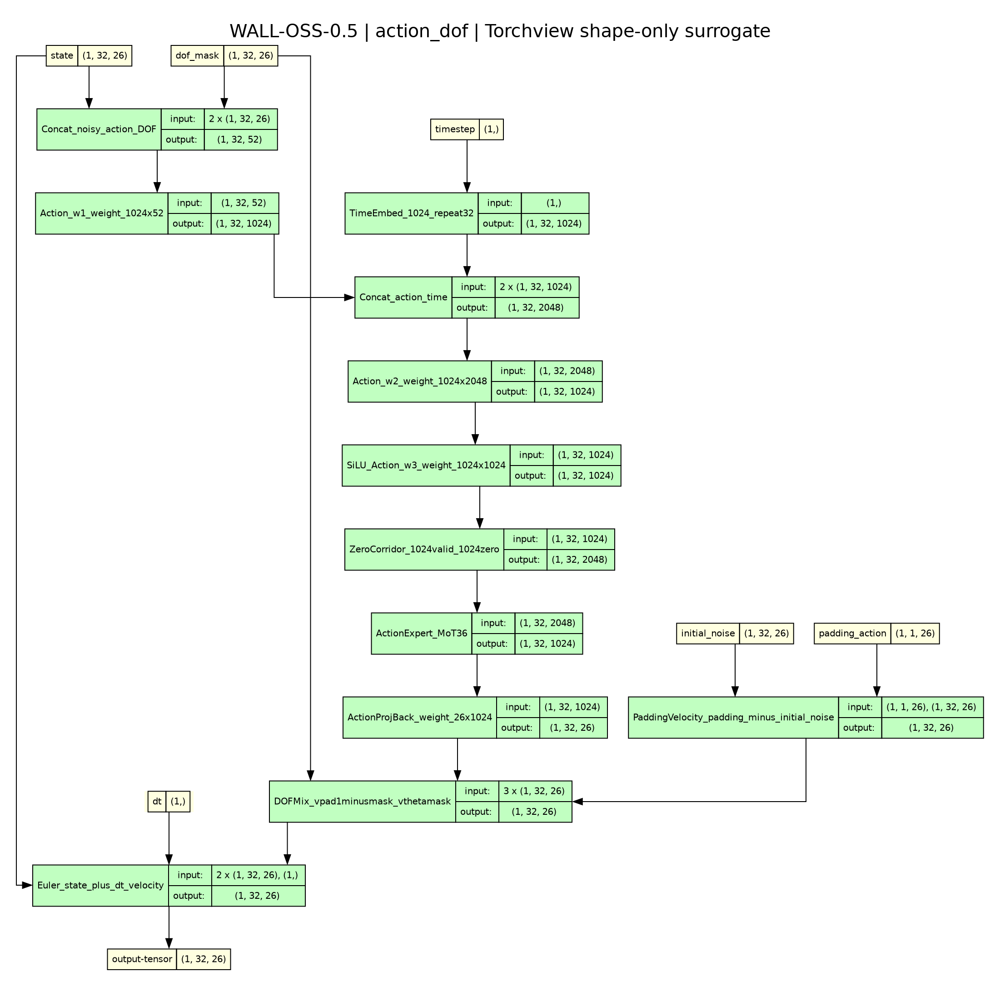

### 3.4 从模型语义到十输入部署接口

前述背景现在可以逐项映射为当前 state-string `full_flow` 的部署接口：

| 语义决定 | 当前 ABI 表现 |
|---|---|
| 两路 448 图像、512 视觉 token | `pixel_values [2048,1176] f32` |
| 606/638 双段序列 | `input_ids [1,638] i64`、`position_ids [3,1,638] i64`、`mask3d [1,638,638] bool` |
| H=32、D=26 的 Flow 状态 | `noise [1,32,26] f32` |
| 26D 无效维度的官方参考动作 | `padding_action [1,1,26] f32` |
| 10 个 solver 区间、11 个 Flow 时间点 | `times [11] f32` |
| suffix 的 32 个当前 action query | `postfix_pos [3,1,32] i64`、`suffix_mask [1,32,638] bool` |
| 动作有效性与速度混合 | `dof_mask [1,32,26] f32` |

十个输入按当前导出顺序写全为：

```text
input_ids      [1,638]      i64
pixel_values   [2048,1176]  f32
position_ids   [3,1,638]    i64
mask3d         [1,638,638]  bool
noise          [1,32,26]    f32
padding_action [1,1,26]     f32
times          [11]         f32
postfix_pos    [3,1,32]     i64
suffix_mask    [1,32,638]   bool
dof_mask       [1,32,26]    f32
```

生产 `main` 只返回 `z_10 [1,32,26] f32`。36 层 prefix K/V、每步速度和中间轨迹在图内传递；`full_flow_trace` 使用独立诊断接口 读取这些中间结果。Host 侧接收生产输出后执行官方反归一化。这份部署接口只包含推理输入。

这份签名同时解释了通用接入方法的复用边界：替换模型时，条件编码与 solver 的编译流程可以保留；图像网格、prefix bucket、专家分段、H/D、DOF、mask、时间网格和 finalizer 必须重新核对。adapter 必须把 checkpoint 语义完整翻译成上述显式契约。

第 4、5 章将用完整导出日志、IREE 原生编译日志和真实 `@main` 调用逐项核验这份模型契约。

下一章将沿这份契约阅读 `StaticFullFlow`：先看 context 与 t=0 embedding 怎样形成 638 行输入，再看 prefill 如何产生首步速度和可复用 K/V，最后看 9 次 suffix/Euler 如何在同一生产图中得到 `z_10`。

## 四、整图实现：StaticFullFlow 的静态模块与设备 ABI

`StaticFullFlow` 由三类计算节点组成：`StaticVisionTextContext` 构造完整序列，`StaticJointPrefill` 计算首次速度和共享 K/V，`StaticDenoiseEulerLoop` 完成后续 9 次速度与状态更新。生产 artifact 只有一个 `main`、一个 VMFB 和一个匹配的 IRPA；诊断用的 `full_flow_trace` 是另一份导出。

### 4.1 视觉与文本/状态上下文怎样进入图

`wall_x/serving/backend/static_flow/vision.py` 保留官方 ViT 的 patch embedding、32 个 block、window/full attention、RoPE、merger 和逆重排。当前静态 profile 是 2048 个 patch、32 个 64-token window、两个 1024-token full-attention segment，最后得到 512 个 merged feature。metadata 在构造模块时一次性计算，forward 只使用静态 tensor 运算；动态 window 形状直接报错。

`window_index`、`reverse_index` 和 ViT block 结构确定了静态拓扑，rotary 常量的生成设备则确定数值来源。`build_vision_profile` 在 `visual.rotary_pos_emb.inv_freq.device` 上生成并索引三角函数表，再注册为 `vision_cos/vision_sin` buffer，使静态视觉链与官方 CUDA forward 使用同设备常量。相同设备下，官方 eager 与静态 eager 的 32 层 block、merger 和最终特征均 `relmax=0.0`。整图适配因此同时固定算子顺序、常量设备和数值来源。

当前整图 serving 选择官方支持的 `WALLX_VISION_ATTN_IMPLEMENTATION=eager` 作为严格数值对齐配置，使用与官方 eager 相同的 QK、mask、fp32 softmax 和 PV 顺序，使 ViT attention 的每个阶段都可 trace 并逐项对照。核心源码保持下面的顺序，窗口或 full-attention segment 只在外层做静态分批：

```python
scores = torch.matmul(q, k.transpose(-1, -2)) / math.sqrt(self.head_dim)
probabilities = torch.softmax(scores, dim=-1, dtype=torch.float32).to(q.dtype)
return torch.matmul(probabilities, v)
```

官方 SDPA 与 FlashAttention2 仍可作为独立对照，它们与 eager 的输出差异必须单独测量；eager 对齐结论仅适用于 eager profile。

文本和状态 token 通过官方 `embed_tokens` 进入图，图像特征再按原顺序写回 `<|image_pad|>` 位置。关键的静态 scatter 用 `cumsum` 计算目标位置，避免动态 `masked_scatter` 的输出形状：

```python
base = self.embed_tokens(input_ids)
image_features = self.vision(pixel_values)
image_mask = input_ids == self.image_token_id
return _ordered_scatter(base, image_mask, image_features)

# _ordered_scatter 的核心
rank = mask.to(torch.int64).cumsum(dim=1) - 1
rank = rank.clamp(min=0, max=n - 1).reshape(-1)
gathered = values.reshape(n, -1)[rank].reshape(base.shape)
return torch.where(mask.unsqueeze(-1), gathered.to(base.dtype), base)
```

当前 checkpoint 的 `use_state_string_representation=true`，所以 proprioception 已在 Host 被离散化成文本 token；图内因此直接使用 `embed_tokens` 处理这些状态 token。对其它配置，`StaticVisionTextStateContext` 另提供显式 tensor-state ABI，并执行独立导出与验证。

### 4.2 `StaticFullFlow`：把 t=0、prefill 和 solver 串成一个 main

`wall_x/serving/backend/static_flow/full.py` 的 `_execute` 是整图的主干。它先在图内计算 t=0 action embedding，再经过 prefill 得到 K/V 和第一次 Euler 状态，最后把同一组 K/V 和 `v_padding` 传给 solver：

```python
action_embed, _ = self.ap.step(
    timestep=times[0].reshape(1), noisy_action=noise, dof_mask=dof_mask)
action_embed = action_embed.reshape(-1, context_features.shape[-1]) \
    .to(context_features.dtype)
action_mask = input_ids == self.action_token_id
embeds = _ordered_scatter(context_features, action_mask, action_embed)

k, v, v0, x0 = self.prefill(
    embeds.float(), position_ids, mask3d, noise, padding_action,
    (times[1] - times[0]).reshape(1), dof_mask=dof_mask)
v_padding = padding_action - noise
if self.TRACE:
    final, velocities, trajectory = self.solver(
        x0, times, postfix_pos, suffix_mask, k, v, v_padding,
        dof_mask=dof_mask)
    return (final, embeds.float(), k, v, v0, x0, velocities, trajectory)
final = self.solver.forward_final(
    x0, times, postfix_pos, suffix_mask, k, v, v_padding,
    dof_mask=dof_mask)
return (final,)
```

`StaticDenoiseEulerLoop.forward_final` 将后续 9 次静态展开。`times` 直接消费官方输入的 11 个时间点，保留实际的 shift、scale 和 fp32 减法顺序：

```python
x = x0
for i in range(self.num_inference_timesteps - 1):
    timestep = times[1 + i].reshape(1)
    dt = times[2 + i] - times[1 + i]
    velocity = self.step(
        x, timestep, postfix_pos, suffix_mask,
        k_past_f32, v_past_f32, v_padding=v_padding,
        dof_mask=dof_mask)
    x = x + dt * velocity
return x
```

生产 `_execute` 调用 `forward_final` 并只返回 final，因此 `main` 只有一个 `[1,32,26]f32` 输出。诊断分支调用带 `velocities` 与 `trajectory` stack 的 `forward`，由独立的 `StaticFullFlowTrace` 导出 final、embeds、K/V、v0、x0、9 个速度和 10 个状态。两种路径的最终物理动作已经逐位一致。

### 4.3 36 层主链的数值顺序与 KV ABI

`StaticJointPrefill` 逐层保留官方的 expert-wise norm、QKV/O 投影、MLP、共享 attention head、mRoPE 和 final norm。Q/K/V 拼接后统一升到 fp32，复刻官方 permute/unpermute 路径的 dtype 行为；prefix cache 存 post-rope K，V 保持原值。attention mask 来自官方 `update_joint_attention_mask_2d`，并保留 pad query 的对角自可见处理。

部署 artifact 使用 fp16-score math attention。QK 输入和 score 物化使用 fp16，MMA 累加保持 fp32，mask 加法后转 fp32 做 softmax，PV 使用 `vf.dtype`：

```python
qf16 = qf.to(torch.float16)
kf16 = kf.to(torch.float16)
add_mask = torch.where(mask4[:, 0], 0.0, float("-inf")) \
    .to(torch.float16).unsqueeze(1)
sc = torch.matmul(qf16, kf16.transpose(-1, -2)) * (128 ** -0.5)
sc = sc + add_mask
p = torch.softmax(sc.to(torch.float32), dim=-1).to(vf.dtype)
attn = torch.matmul(p, vf)
```

suffix 接收完整的 `[36,1,2,638,128]` fp32 K/V，模块内部裁出 606 行 prefix，再拼当前 32 行：

```python
k_past = k_past_f32[:, :, :, :606, :]
v_past = v_past_f32[:, :, :, :606, :]
```

在整图中，这些 K/V 是 prefill 与 solver 之间的 tensor 依赖。每个 suffix 重新形成当前 action 的 32 行 K/V，prefix 的 606 行继续复用；生产 Host 不接触这组中间缓存。

### 4.4 导出、部署接口 和诊断接口

`tools/iree/export_full_flow.py` 的 state-string 输入为 10 个张量：

```text
input_ids[1,638] i64 · pixel_values[2048,1176] f32
position_ids[3,1,638] · mask3d[1,638,638]
noise[1,32,26] · padding_action[1,1,26]
times[11] · postfix_pos[3,1,32] · suffix_mask[1,32,638]
dof_mask[1,32,26]
```

生产导出 `full_flow.mlir` 的 main 只有一个 `[1,32,26]f32` 输出，`--trace` 则写 `full_flow_trace.mlir`，共享同一组外置参数名。当前参考构建产物为：

| 文件 | 大小 | 用途 |
|---|---:|---|
| `full_flow.mlir` | 15,608,302 B | 生产整图 Torch-level IR |
| `full_flow.weights.irpa` | 8,341,872,640 B | 视觉、主链和 action head 的外置权重 |
| `full_flow.vmfb` | 3,057,029 B | `sm_120` 生产可执行模块 |

`IreeExpandedSession` 只 mmap 这一组 VMFB/IRPA，生产每次请求调用一次 `main`，并强制输出数量为 1；只有显式选择 trace VMFB 时才读取其它诊断张量。`IreeExpandedBackend` 用 `WALLX_BACKEND=iree-expanded` 接入官方 wrapper。

下面的控制台记录来自当前 clean worktree 的两次真实导出。`full-flow profile` 直接给出 2048 patches、512 merged tokens、32 个 window 和两个 1024-token full-attention segment；MLIR 与 IRPA 的字节数和 SHA-256 也在同一次执行中输出。

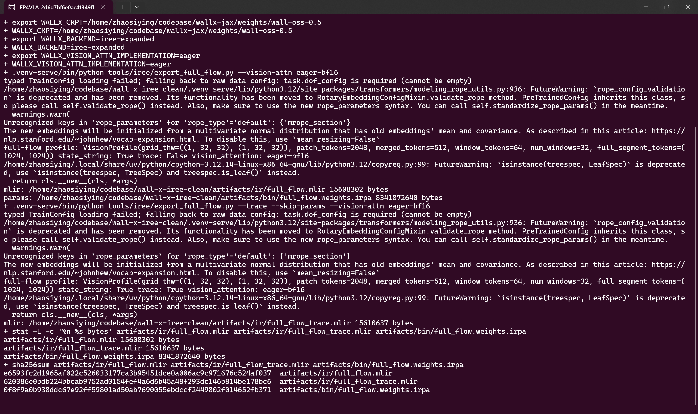

**关键原生日志节选：`implementation_evidence/native_logs/full_flow_export.console.log`（完整文件 5322 bytes，随 evidence 保存）**

```text
+ .venv-serve/bin/python tools/iree/export_full_flow.py --vision-attn eager-bf16
typed TrainConfig loading failed; falling back to raw data config: task.dof_config is required (cannot be empty)
/home/zhaosiying/codebase/wall-x-iree-clean/.venv-serve/lib/python3.12/site-packages/transformers/modeling_rope_utils.py:936: FutureWarning: `rope_config_validation` is deprecated and has been removed. Its functionality has been moved to RotaryEmbeddingConfigMixin.validate_rope method. PreTrainedConfig inherits this class, so please call self.validate_rope() instead. Also, make sure to use the new rope_parameters syntax. You can call self.standardize_rope_params() in the meantime.
  warnings.warn(
Unrecognized keys in `rope_parameters` for 'rope_type'='default': {'mrope_section'}
The new embeddings will be initialized from a multivariate normal distribution that has old embeddings' mean and covariance. As described in this article: https://nlp.stanford.edu/~johnhew/vocab-expansion.html. To disable this, use `mean_resizing=False`
full-flow profile: VisionProfile(grid_thw=((1, 32, 32), (1, 32, 32)), patch_tokens=2048, merged_tokens=512, window_tokens=64, num_windows=32, full_segment_tokens=(1024, 1024)) state_string: True trace: False vision_attention: eager-bf16
/home/zhaosiying/.local/share/uv/python/cpython-3.12.14-linux-x86_64-gnu/lib/python3.12/copyreg.py:99: FutureWarning: `isinstance(treespec, LeafSpec)` is deprecated, use `isinstance(treespec, TreeSpec) and treespec.is_leaf()` instead.
  return cls.__new__(cls, *args)
mlir: /home/zhaosiying/codebase/wall-x-iree-clean/artifacts/ir/full_flow.mlir 15608302 bytes
params: /home/zhaosiying/codebase/wall-x-iree-clean/artifacts/bin/full_flow.weights.irpa 8341872640 bytes
full-flow profile: VisionProfile(grid_thw=((1, 32, 32), (1, 32, 32)), patch_tokens=2048, merged_tokens=512, window_tokens=64, num_windows=32, full_segment_tokens=(1024, 1024)) state_string: True trace: True vision_attention: eager-bf16
/home/zhaosiying/.local/share/uv/python/cpython-3.12.14-linux-x86_64-gnu/lib/python3.12/copyreg.py:99: FutureWarning: `isinstance(treespec, LeafSpec)` is deprecated, use `isinstance(treespec, TreeSpec) and treespec.is_leaf()` instead.
  return cls.__new__(cls, *args)
mlir: /home/zhaosiying/codebase/wall-x-iree-clean/artifacts/ir/full_flow_trace.mlir 15610637 bytes
+ stat -L -c '%n %s bytes' artifacts/ir/full_flow.mlir artifacts/ir/full_flow_trace.mlir artifacts/bin/full_flow.weights.irpa
artifacts/ir/full_flow.mlir 15608302 bytes
artifacts/ir/full_flow_trace.mlir 15610637 bytes
artifacts/bin/full_flow.weights.irpa 8341872640 bytes
+ sha256sum artifacts/ir/full_flow.mlir artifacts/ir/full_flow_trace.mlir artifacts/bin/full_flow.weights.irpa
e6593fc2d1965af022c526033177ca3b95451dce0a006ac9c971676c524af037  artifacts/ir/full_flow.mlir
620386e0bdb224bbcab9752ad0154fef4a6d6b45a48f293dc146b814be178bc6  artifacts/ir/full_flow_trace.mlir
0f8f9a0b938ddc67e92ff59801ad50ab7690055ebdccf2449802f014652fb371  artifacts/bin/full_flow.weights.irpa
```
### 4.5 整图之外仍需保留的Host 侧操作


“整图”覆盖完整的可张量化模型计算图，Host 侧程序通过 ABI 与图协作。当前 ABI 外仍有 JPEG 解码、图像 resize/normalization、tokenizer、state-string 量化、`grid_thw` 和 3D position/mask 构造、noise 生成、最终反归一化、msgpack 和 WebSocket。`position_ids` 与 mask 是图的显式输入；Host 的验证计数确认 `pytorch_vision_calls=0`、`pytorch_action_step_calls=0`。

## 五、MLIR/IREE：从静态 PyTorch 图到设备执行

前文定义的张量契约和静态模块构成编译器接收的输入。接入新模型时，Python 侧的改写与 MLIR pass 是两层工作：改写负责把动态、隐式、依赖Host 侧状态的计算表达成明确的 tensor graph；IREE 的既有 pass 再负责转换、分派、设备资源配置和 CUDA 代码生成。本项目使用默认编译管线，图生效的证据来自真实阶段 IR、dispatch、runtime 调用和数值对拍。

### 5.1 整图导出与参数外置

`tools/iree/export_full_flow.py` 先按 checkpoint 的 state-string/tensor-state 配置选择 `StaticFullFlow` 或对应 trace 类，再注册外置参数并构造十个生产输入。核心顺序为：

```python
module_cls = StaticFullFlowTrace if args.trace else StaticFullFlow
module = module_cls(
    model, bank["image_grid_thw"], dof_mask=bank["ctx"]["dof_mask"],
    vision_attention=args.vision_attn).cpu().eval()

externalize_module_parameters(module)
example = [
    bank["input_ids"].cpu(),
    bank["pixel_values"].cpu().float(),
    bank["ctx"]["position_ids"].cpu(),
    mask3d,
    bank["noise"].cpu().float(),
    bank["ctx"]["padding_action"].cpu().float().reshape(1, 1, -1),
    bank["ctx"]["times"].cpu().float(),
    bank["postfix"]["position_ids"].cpu(),
    bank["postfix"]["attention_mask"].cpu().bool(),
    dof,
]
exported = export(module, *example)
exported.save_mlir(ir_out)
save_module_parameters(args.params_out, module)
```

`externalize_module_parameters` 是 Turbine 的 Python 辅助函数，给参数和 persistent buffer 加上外置标记；`export` 负责 tracing 和 FX import，保存 Torch-level IR。`save_module_parameters` 将真实权重写入 IRPA，`iree-compile` 再生成 `sm_120` VMFB。权重因此可以独立校验和替换，外置机制避免在 trace 中复制数 GB 常量。

真实 `full_flow.mlir` 的 `@main` 具有十个输入，类型依次对应 `[1,638]si64`、`[2048,1176]f32`、`[3,1,638]si64`、`[1,638,638]i1`、`[1,32,26]f32`、`[1,1,26]f32`、`[11]f32`、`[3,1,32]si64`、`[1,32,638]i1` 和 `[1,32,26]f32`。`#flow.parameter.named<"model"::...>` 将权重引用绑定到 IRPA 的 `model` scope。完整签名和逐行证据见 `implementation_evidence/ir/full_flow/torch_main.txt`。

### 5.2 与本实现直接相关的 pass 和阶段

下面的名称来自默认输入转换管线和 `full_flow` 的真实阶段 IR。它们说明编译器怎样接收已经写好的整图，并依次形成 tensor/linalg、dispatch、设备资源和 VM 调用。

| 证据中的 pass / 阶段 | 在本次接入中的具体作用 |
|---|---|
| `AutoInputConversionPipelinePass` | 属于 IREE 默认输入转换管线，把 Torch/FX 图送入 tensor/linalg 表示。 |
| `ConvertTorchToLinalg` 等转换 pass | 将矩阵、切片、reshape、元素计算等 Torch 语义变成可优化的 linalg/tensor 形式，保留静态 shape。 |
| `OutlineDispatchRegionsPass` | 找出可独立调度的计算区域，为后续设备 dispatch 划边界。 |
| `ConvertDispatchRegionsToWorkgroupsPass` | 把区域变成 workgroup 形式的 `flow.dispatch`，使计算可以作为设备执行单元。 |
| `DeduplicateExecutablesPass` | 合并合法的重复 executable body，避免 36 层中相同结构被无意义地重复保存。 |
| `stream` 阶段 | 将参数、外部输入和中间结果放进资源/异步依赖/timepoint 体系，形成 Host 调度与设备执行的连接。 |
| `executable-configurations` | 为各 dispatch 选择 GPU translation pipeline、workgroup/subgroup 和 lowering config。 |
| `hal` / `vm` 阶段 | 分别形成设备 buffer、executable、command buffer，以及 Host 侧 `vm.export`、`vm.call`、fence 和设备调用 ABI。 |

`full_flow` 的 Flow 阶段包含 176 个 `flow.executable` 和 10766 个 `flow.dispatch`。主函数开头已经出现 ViT patch embedding 的矩阵 dispatch，直接证明视觉塔位于同一份整图：

```mlir
%15 = flow.dispatch @main$async_dispatch_1::@main$async_dispatch_1_matmul_2048x1280x1176_bf16xbf16xf32(%14, %11) : (tensor<2048x1176xbf16>, tensor<1280x1176xbf16>) -> tensor<2048x1280xbf16>
%19 = flow.dispatch @main$async_dispatch_3::@main$async_dispatch_3_reduction_2048x1280_f32(%18, %__parameter_model_context_vision_blocks_0_norm1_weight_tensor_1280xbf16) : (tensor<2048x1280xbf16>, tensor<1280xbf16>) -> tensor<2048x1280xbf16>
%20 = flow.dispatch @main$async_dispatch_4::@main$async_dispatch_4_matmul_2048x3840x1280_bf16xbf16xf32(%19, %__parameter_model_context_vision_blocks_0_attn_qkv_weight_tensor_3840x1280xbf16) : (tensor<2048x1280xbf16>, tensor<3840x1280xbf16>) -> tensor<2048x3840xbf16>
```

`2048×1176→2048×1280` 对应 patch projection，随后的 norm 与 `2048×1280→2048×3840` 对应视觉 block 的 fused QKV。`flow.executable` 将这些工作包装成可导出的执行单元；Stream 阶段再建立 `stream.binding.subspan`、异步资源和 `stream.cmd.dispatch`。

### 5.3 attention 在 full_flow 中的真实 lowering

`full_flow` 的 input 阶段包含 324 处 `iree_linalg_ext.attention`。suffix 的一处真实形态为：

```mlir
%5562 = iree_linalg_ext.attention <indexing_maps = [#map24, #map25, #map26, #map27, #map28, #map29]> ins(%collapsed_3437, %collapsed_3438, %collapsed_3439, %cst, %collapsed_3440 : tensor<16x32x128xbf16>, tensor<16x638x128xbf16>, tensor<16x638x128xbf16>, f32, tensor<16x32x638xi1>) outs(%5561 : tensor<16x32x128xbf16>)
```

这里 `32` 是 suffix query 数，`638` 是 key 数，`128` 是 head dimension。到 `executable-configurations` 阶段，相关 dispatch 变为 `iree_linalg_ext.online_attention`，同时产生输出、running max 和 running sum。以下省略 lowering 属性，保留实际输入输出结构：

```mlir
%24:3 = iree_linalg_ext.online_attention <...>
  ins(%q, %k, %v, %scale, %mask : ...)
  outs(%out, %max, %sum : tensor<...xf32>, tensor<...xf32>, tensor<...xf32>)
```

`online` 将 softmax 的归一化状态随 attention 分块处理，减少完整 score 矩阵的物化压力。部署的 fp16 math-prefill 采用显式 QK matmul、fp32 softmax 和 PV matmul；suffix 的 `online_attention` 证据只用于对应的 suffix dispatch。生产编译使用 IREE 内置 attention lowering 与默认 pass pipeline。

### 5.4 Flow、Stream、HAL、VM 各自由谁接管

```text
Torch-level IR
  → input conversion / linalg
  → flow.dispatch / flow.executable
  → stream resource + async timepoint + cmd dispatch
  → configured HAL executable / CUDA translation
  → vm.export + host fence/device calls
```

`executable-configurations` 中的 `#iree_gpu.pipeline<TileAndFuse>`、`Distribute`、`VectorDistribute` 均为 IREE 内置 GPU 翻译管线枚举。它们与 `lowering_config` 一起决定分块、workgroup/subgroup 和归约方式。

HAL/VM 的边界也可以在真实 IR 中看到：

```mlir
vm.export @main$async attributes {iree.abi.model = "coarse-fences", iree.abi.stub}
vm.func private @main(%arg0: !vm.ref<!hal.buffer_view>, ...) {
  %ref_2 = vm.call @main$async(%arg0, ..., %ref_1)
  vm.call.variadic.yieldable @hal.fence.await(%c-1, %zero, %ref_1)
  vm.return %ref_2
}
vm.export @main attributes {iree.abi.stub}
```

这解释了 `IreeExpandedSession` 如何通过 `full_flow_mod.main(...)` 调用设备程序：VM 负责 Host ABI，HAL 负责设备执行，IRPA 参数模块负责提供权重。`full_flow` 的 VM export 接收十个 buffer view 并返回一个 buffer view；9 次 solver 已在导出时展开为图内计算，Python 每次请求只调用一次 `main`。

完整的整图阶段摘录和执行日志保存在 `implementation_evidence/ir/full_flow/`，其中 `manifest.json` 记录实际编译命令、输入输出数量、artifact 哈希和当前验收结论。

下面的 24,697 行控制台记录来自同一份生产 MLIR 的真实 `iree-compile`。命令启用了 IREE 官方的 `--mlir-timing`、`--mlir-pass-statistics`、阶段 dump 和 HAL executable configuration dump。该日志由 `iree-compile` 直接输出：开头的 `AutoInputConversionPipelinePass`、中间的 dispatch/Stream/HAL/VM pass、末尾的 `107.4352` 与 `53.4331` 两列总计都由编译器直接输出。截图展示终端末尾，日志块只保留关键行，完整文件随 evidence 保存。

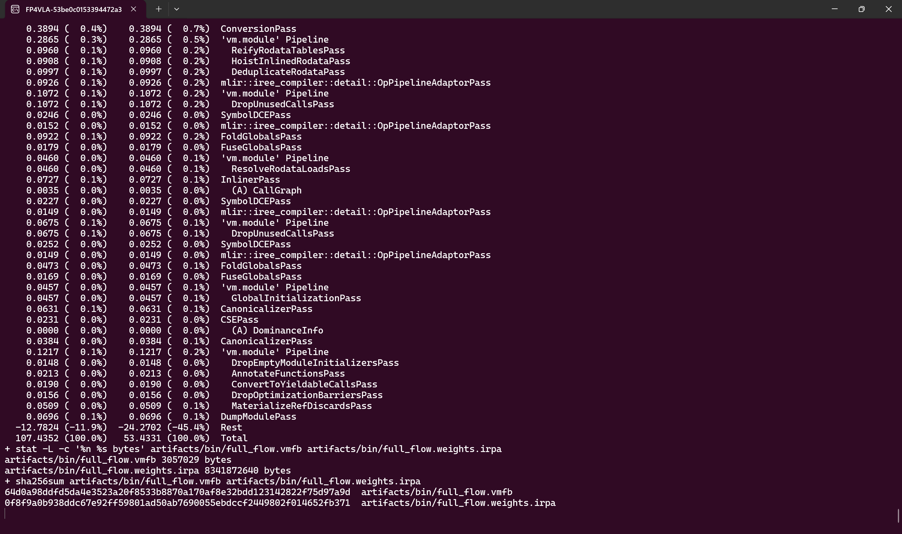

**关键原生日志节选：`implementation_evidence/native_logs/full_flow_iree_compile.console.log`（完整文件 1640762 bytes，随 evidence 保存）**

```text
+ .venv-serve/bin/iree-compile artifacts/ir/full_flow.mlir --iree-hal-target-device=cuda --iree-cuda-target=sm_120 --dump-compilation-phases-to=/tmp/wallx_native_full_flow_phases --iree-hal-dump-executable-configurations-to=/tmp/wallx_native_full_flow_hal --mlir-timing --mlir-pass-statistics --mlir-print-ir-after-failure -o artifacts/bin/full_flow.vmfb
===-------------------------------------------------------------------------===
                         ... Pass statistics report ...
===-------------------------------------------------------------------------===
AutoInputConversionPipelinePass
IREEImportPublicPass
ImportMLProgramPass
SanitizeModuleNamesPass
DemoteF64ToF32Pass
DumpModulePass
ConvertStreamableOpsPass
OutlineDispatchExternsPass
OutlineDispatchRegionsPass
AnnotateDispatchesPass
'flow.executable' Pipeline
  StripDebugOpsPass
mlir::iree_compiler::detail::OpPipelineAdaptorPass
DeduplicateExecutablesPass
  -12.7824 (-11.9%)  -24.2702 (-45.4%)  Rest
  107.4352 (100.0%)   53.4331 (100.0%)  Total
+ stat -L -c '%n %s bytes' artifacts/bin/full_flow.vmfb artifacts/bin/full_flow.weights.irpa
artifacts/bin/full_flow.vmfb 3057029 bytes
artifacts/bin/full_flow.weights.irpa 8341872640 bytes
+ sha256sum artifacts/bin/full_flow.vmfb artifacts/bin/full_flow.weights.irpa
64d0a98ddfd5da4e3523a20f8533b8870a170af8e32bdd123142822f75d97a9d  artifacts/bin/full_flow.vmfb
0f8f9a0b938ddc67e92ff59801ad50ab7690055ebdccf2449802f014652fb371  artifacts/bin/full_flow.weights.irpa
```
诊断 trace 模块也经过同样的官方编译流程，其完整文件独立保存在 `implementation_evidence/native_logs/full_flow_trace_iree_compile.console.log`。

## 六、Serving：统一 backend 接口与真实执行

上游 serving 框架保持请求边界。`wall_x/serving/backend` 提供共同的 flow-action 调用接口，上游 wrapper 继续负责观测构造、机器人状态、msgpack 与 WebSocket。eager、`torch.compile`、staged IREE 和 expanded IREE 都实现同一接口；lazy registry 只在选中某个后端时导入对应依赖。

### 6.1 Backend registry：选择、显式 artifact 与失败语义

`wall_x/serving/backend/registry.py` 用 import path 注册后端，避免 eager 请求加载 IREE：

```python
_BACKENDS = {
    "eager": ("wall_x.serving.backend.eager", "EagerFlowBackend"),
    "torch-compile": (
        "wall_x.serving.backend.torch_compile", "TorchCompileFlowBackend"),
    "iree": ("wall_x.serving.backend.iree.model", "IreeFlowBackend"),
    "iree-expanded": (
        "wall_x.serving.backend.iree.model", "IreeExpandedBackend"),
}
```

`create_backend` 仅接受注册名称，未知名称直接抛出 `ValueError`。IREE artifact 必须来自显式参数或 `WALLX_IREE_*` 环境变量。staged 需要 prefill/step 两组 VMFB/IRPA，expanded 需要 `WALLX_IREE_FULL_FLOW_VMFB` 与 `WALLX_IREE_FULL_FLOW_IRPA`。缺失文件、未知后端和不支持的输入都会在请求路径上报错并返回给调用方。

### 6.2 `torch.compile`：与 IREE 并列的真实后端

`wall_x/serving/backend/torch_compile.py` 编译同一套静态 prefill/suffix，并复用官方 context、bucket、mask、noise 和 finalizer。`execute_static_flow` 在两个编译区域之间显式 clone K/V 和 `x0`，避免 reduce-overhead replay 复用图缓冲区后破坏后续输入：

```python
k, v, _v0, x0 = prefill(
    inputs_embeds, position_ids, mask3d, noise, padding_action,
    (times[1] - times[0]).reshape(1), dof_mask=dof_mask)
k = k.clone()
v = v.clone()
x = x0.clone()
for index in range(len(times) - 2):
    velocity = suffix(
        x, times[1 + index].reshape(1), postfix_positions, postfix_mask,
        k, v, v_padding=v_padding, dof_mask=dof_mask)
    x = x + (times[2 + index] - times[1 + index]) * velocity
```

构造阶段分别对 prefill 和 suffix 调用 `torch.compile(..., dynamic=False)`，默认 `mode="reduce-overhead"`，也可通过 `WALLX_TORCH_COMPILE_MODE` 选择 default Inductor。它与 IREE 使用同一个 `generate_flow_action` 入口，因而可以在相同输入、同步、finalizer 和输出边界下进行对照。

### 6.3 单模块 IREE session：一次加载、一次 main、一个生产输出

`wall_x/serving/backend/iree/runtime.py` 先注册 `model` scope 的 IRPA provider，再 mmap VMFB。这个顺序保证 `io_parameters` 在模块加载时可解析：

```python
index = rt.ParameterIndex()
index.load(file_path=str(full_flow_irpa))
self._provider = index.create_provider(scope="model")
io_module = rt.create_io_parameters_module(instance, self._provider)
vm = rt.VmModule.mmap(instance, str(full_flow_vmfb))
self.full_flow_mod = rt.load_vm_modules(io_module, vm, config=config)[-1]
```

生产调用把十个输入转换为 DeviceArray，并只将 final 复制到 Host。`_finish` 对生产模块强制 `len(output)==1`，对 trace 模块强制 `len(output)==8`。生产 session 请求 trace reads 会直接报错，诊断 VMFB 与生产 VMFB 的职责保持分离。

### 6.4 `IreeExpandedBackend`：Host 侧准备 metadata，图内生成真实 embeddings

`wall_x/serving/backend/iree/model.py` 校验固定 profile：batch 1、638 tokens、两路图像、`pixel_values [2048,1176]`、512 个图像特征、32 个 action token、26 维动作和 10 个推理步。视频、动态网格、预计算 `inputs_embeds` 和其他 action horizon 需要各自的静态导出。

官方 `_prepare_flow_action_inputs` 同时承担 metadata 准备和模型上下文计算。expanded backend 使用 placeholder embeddings 调用它，并设置 `skip_action_embedding=True`：

```python
placeholder = torch.zeros(
    1, self.sequence_length, int(self.model.config.hidden_size),
    device=ids.device, dtype=weight.dtype)
ctx = super().prepare_ctx(
    action_horizon, action_dim, num_inference_timesteps,
    padding_action, noise, batch_inputs,
    inputs_embeds=placeholder,
    pixel_values=None, proprioception=None,
    skip_action_embedding=True)
```

placeholder 只驱动官方时间、position、mask、normalizer 和 postfix metadata 逻辑，`full_flow` 接收原始 `input_ids` 与 `pixel_values`。真实视觉、文本、状态与 t=0 action embedding 全部由图内 `StaticVisionTextContext` 和共享 action preprocessor 计算。最终物理输出继续调用官方 `_finalize_flow_action_output`，保留 normalizer、DOF 和可选 `gt_action`。

### 6.5 可变长度输入进入固定 638 bucket

真实 serving 的状态离散化会改变文本 token 数。`WallxFlowBackend._pad_to_bucket` 在左侧补 prefix，保持右侧 32 个 action token 和 `[0,606)` / `[606,638)` 双段布局：

- `input_ids` 使用 tokenizer 的 pad id，`attention_mask` 补 0，`moe_token_types` 补 expert-0。
- prefill 对 pad query 只保留对角自可见项，真实 query 的 pad key 全部屏蔽。
- suffix 使用官方 `_prepare_flow_postfix` 返回的 mask，继承 pad key 屏蔽和 action causal 可见性。
- 超过 638、左 padding 后 prefix 仍非 606、action horizon 非 32 或带自定义 positional mask 的请求需要独立 bucket 和验证。

当前 expanded 短桶对拍中，原始 635-token 输入补到 638 后，最终物理动作 relmax 为 `1.17349%`，通过 2% 门槛。这个结果覆盖一个冻结短输入，动态长度族仍需逐 bucket 验收。

### 6.6 原生 serving 日志与动作响应

`scripts/iree_serving.sh` 通过 process substitution 将服务器 stdout/stderr 同时写入终端和 `SERVER_LOG`。下面的执行先出现 `serving backend ACTIVE (name=iree-expanded; no implicit fallback)`，随后客户端解码并打印完整 WebSocket 响应。`predict_action` 的 832 个数值全部来自这次实际请求，`server_timing.infer_ms=8061.880` 包含第一次请求的 session 初始化，只用于冷启动分析。

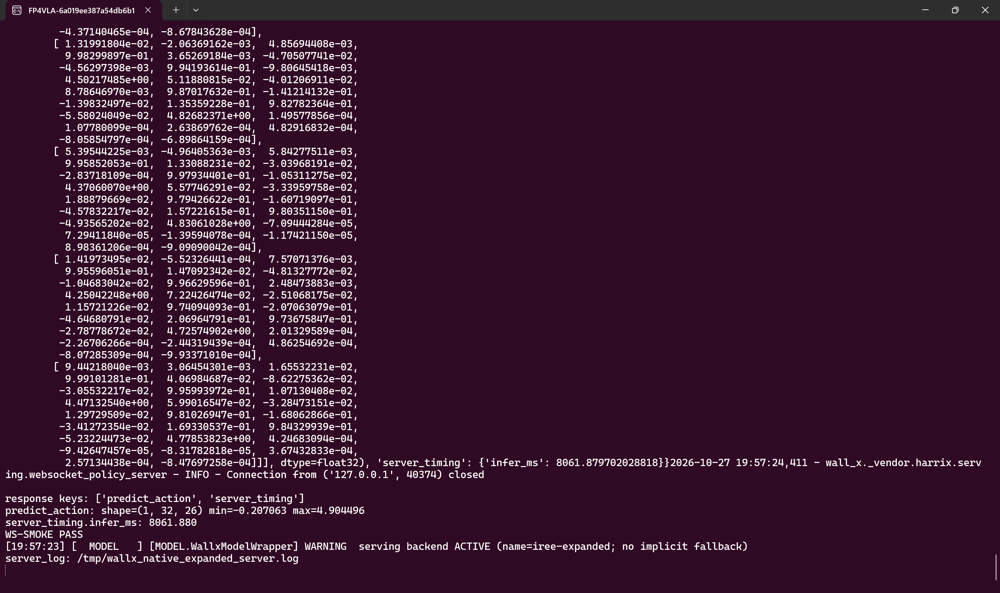

**关键原生日志节选：`implementation_evidence/native_logs/expanded_serving.console.log`（完整文件 75957 bytes，随 evidence 保存）**

```text
[19:57:23] [  MODEL   ] [MODEL.WallxModelWrapper] WARNING  serving backend ACTIVE (name=iree-expanded; no implicit fallback)
2026-10-27 19:57:24,401 - wall_x.utils.timers - INFO - generate_flow_action took 7960.586 ms to execute
[19:57:24] [  MODEL   ] [MODEL.WallxModelWrapper] INFO     flow action generation done
[19:57:24] [  MODEL   ] [MODEL.WallxModelWrapper] INFO     saved flow action to robot_state_action_data
2026-10-27 19:57:24,402 - wall_x.utils.timers - INFO - infer_flow took 8048.800 ms to execute
metadata keys: ['batch_enabled', 'model', 'env']
COMPLETE decoded response:
{'predict_action': array([[[-7.32350349e-03, -7.83124566e-03,  5.17651439e-03,
          9.99539137e-01,  4.44734097e-03, -8.55052471e-03,
          1.29723549e-03,  9.99184251e-01, -2.49723792e-02,
         -3.41272354e-02,  1.69330537e-01,  9.84329939e-01,
         -5.23224473e-02,  4.77853823e+00,  4.24683094e-04,
         -9.42647457e-05, -8.31782818e-05,  3.67432833e-04,
          2.57134438e-04, -8.47697258e-04]]], dtype=float32), 'server_timing': {'infer_ms': 8061.879702028818}}2026-10-27 19:57:24,411 - wall_x._vendor.harrix.serving.websocket_policy_server - INFO - Connection from ('127.0.0.1', 40374) closed

response keys: ['predict_action', 'server_timing']
predict_action: shape=(1, 32, 26) min=-0.207063 max=4.904496
server_timing.infer_ms: 8061.880
WS-SMOKE PASS
[19:57:23] [  MODEL   ] [MODEL.WallxModelWrapper] WARNING  serving backend ACTIVE (name=iree-expanded; no implicit fallback)
server_log: /tmp/wallx_native_expanded_server.log
```
服务器自身的独立输出另保存在 `expanded_server_only.console.log`。动作数组来自真实模型响应；26 个数值按 action schema 解释；任务成功率由独立任务评测确定。

## 七、关键算子源码逐段阅读

本节按 tensor 在整图中的流动顺序读取关键算子。每段代码都对应具体的 shape、dtype、路由或数值约束。

### 7.1 `StaticPrefillLayer`：先恢复双段 hidden，再恢复 joint attention

文件：`wall_x/serving/backend/static_flow/prefill.py`。核心顺序是分段 norm → expert QKV → 合并序列 → mRoPE → attention → 分段 O/MLP → residual：

```python
p0, _ = self.n0(h[:s0, : self.d0])
p1, _ = self.n1(h[s0:, : self.d1])
qkv0 = self.qkv0(p0.to(self.qkv0.weight.dtype))
qkv1 = self.qkv1(p1.to(self.qkv1.weight.dtype))
q0, k0, v0_ = torch.split(qkv0, [2048, 256, 256], dim=-1)
q1, k1, v1_ = torch.split(qkv1, [2048, 256, 256], dim=-1)
q = torch.cat([q0, q1], dim=0).to(torch.float32).view(1, total, 16, 128)
k = torch.cat([k0, k1], dim=0).to(torch.float32).view(1, total, 2, 128)
v = torch.cat([v0_, v1_], dim=0).to(torch.float32).view(1, total, 2, 128)
q, k = self._mrope(q.contiguous(), k.contiguous(), cos_h, sin_h,
                   self.mrope_section)
```

`qkv0` 的输入是 `[606,2048]`，`qkv1` 的输入是 `[32,1024]`；两者输出都为 2560 维，所以可以在序列维合并。合并后升 fp32 是为了复刻官方 permute/unpermute 的 dtype 路径，随后 Q 变为 `[1,638,16,128]`，K/V 变为 `[1,638,2,128]`。`self._mrope` 直接绑定 `m_rope._pytorch_fallback`，官方 `OpsProxy` 的 lazy resolver 带锁和动态 import，静态模块因此直接绑定已验证的 `m_rope._pytorch_fallback`，并完整执行 Q/K 旋转。

attention 后，expert-1 的 1024 维 O 输出要放回 2048 维 residual：

```python
out = torch.cat([o0_out.to(h.dtype),
                 torch.cat([o1_out.to(h.dtype),
                            torch.zeros(s1, self.d0 - self.d1,
                                        dtype=h.dtype, device=h.device)], dim=1)], dim=0)
h = h + out
residual = h
# post-attention norm 和两路 MLP 同样保留 zero corridor
return residual + mfull, k_t.contiguous(), v_t.contiguous()
```

`k_t` 是 post-mRoPE 的 K，`v_t` 保持 V 原值。`cos_h/sin_h` 和 head-expanded mask 在整个模块调用开始时计算一次，36 层共享，避免每层重复产生纯带宽 dispatch。部署的 fp16-score 分支只替换 attention 的 score 计算，其他布局不变。

### 7.2 `StaticDenoiseStep`：把 action embedding、36 层和速度头放进同一张图

文件：`wall_x/serving/backend/static_flow/suffix.py`。suffix 同时执行当前 action 的时间嵌入、36 层 Transformer、KV 拼接和最终速度头：

```python
emb, cond = self.ap.step(timestep=timestep, noisy_action=noisy_action,
                         dof_mask=self.dof_mask)
h = emb.reshape(1, -1, self.hidden).to(torch.bfloat16)
cos, sin = self.rotary(h, postfix_pos)
for i, layer in enumerate(self.layers):
    h = layer(h, cond, k_past[i], v_past[i], cos, sin, suffix_mask)
fin, _ = self.final_norm(h[:, : self.dim_e1], cond)
h = torch.cat([fin.to(h.dtype),
               torch.zeros(a_len, h.shape[1] - self.dim_e1,
                           dtype=h.dtype, device=h.device)], dim=1)
pred = self.ap.action_proj_back(h[:, : self.action_hidden].to(torch.float32))
v = pred.reshape(1, a_len, -1)
if v_padding is not None:
    v = v_padding * (1.0 - self.dof_mask) + v * self.dof_mask
```

`self.ap.step` 内部完成 `26+26→1024` 的 action/DOF 投影和 timestep 融合；`StaticFullFlow` 让 t=0、prefill projection 和所有 suffix 共享同一个官方 action preprocessor。每层先对 1024 有效通道做 norm，再从 1024 输入产生 16Q/2KV 的 128 维头，拼接 `[prefix|current]` K/V，最后回到 26 维速度。`gated_residual_static` 保留官方的 gate 语义；当前 checkpoint 的 `use_adarms=False`，所以 gate 为 `None` 时退化为普通 `x+y`。

### 7.3 官方 noise 注入：让对拍共享同一个初始随机场

官方 `generate_flow_action` 增加显式 `noise` 参数转发，默认 `noise=None` 时仍由官方随机数生成器产生随机场：

```python
if noise is None:
    noise = torch.randn(size=(batch_size, action_horizon, action_dim),
                        dtype=torch.float32, device=inputs_embeds.device)
else:
    noise = noise.to(device=inputs_embeds.device, dtype=torch.float32)
```

验证脚本将同一个 tensor 分别交给 official 与 expanded backend。`IreeExpandedBackend` 再把 `ctx["noise"]` 作为 `full_flow` 的第五个输入、第二个浮点输入，图内的 t=0 embedding、prefill、`v_padding` 和 Euler 都消费这份初始状态。这样测得的差异可以归因于 dtype、attention、KV 布局和运行时实现。

## 八、验证链：调用边界与数值门槛分别验收

数值对拍使用同一 checkpoint、显式 noise 和冻结 bank。`verify_full_flow.py` 同时检查 context、36 层 K/V、首步状态、9 个速度、10 个轨迹状态、最终物理动作和生产调用边界；`--official-attn eager` 固定官方视觉对照配置。

### 8.1 当前整图数值结果

| 检查 | 实测 relmax | 门槛/结论 |
|---|---:|---|
| 最终归一化动作 vs fresh official | 1.2915% | 通过（<2%） |
| 最终物理动作 vs fresh official | 0.8330% | 通过（<2%） |
| final vs same-context static | 0.8088% | 通过（<2%） |
| context vs fresh official / Python static | 6.1265% | **失败（>2%）** |
| max V cache | 10.6557% | **失败（>6%）** |
| max K cache | 3.6651% | 通过（<6%） |
| max velocity | 0.7882% | 通过（<2%） |
| v0 / x0 | <0.24% | 通过 |

当前证据指向 patch/GEMM 开始的微小 BF16 舍入差在深层放大，block-0 的 patch 是首个非零差异点；`math-fp32` 与 `--iree-opt-level=O0` 配置下仍能观察到这项漂移。最终动作的有限通过因此与 context/KV 的严格失败并列报告，当前结论保持 **experimental-only**。

### 8.2 生产、诊断与 serving 检查

| 检查 | 覆盖范围 | 参考结果 |
|---|---|---|
| `test_noise_injection.py` | 官方显式 noise 注入与复现 | 同 noise 逐位一致 |
| Python static vision vs official eager | 32 个 ViT block、merger、最终特征 | 同设备 rotary 下逐位一致 |
| `verify_full_flow.py` | context、K/V、速度、轨迹、final、调用边界 | 最终动作通过；context/V 严格失败 |
| production vs trace | 两种 VMFB 的最终物理动作 | 数组逐位一致 |
| expanded short bucket | 635→638 padding、mask、RoPE、finalizer | relmax `1.17349%`，PASS |
| expanded WebSocket / policy smoke | 官方协议、动作 shape/有限值、计时、真实 backend | 断言全部通过 |

生产验证还断言 `session_calls=1`、`pytorch_vision_calls=0`、`pytorch_action_step_calls=0`，并强制生产输出数为 1。严格结果与有限实验结果分开打印：

```text
RESULT: FAIL
STRICT_RESULT: FAIL
EXPERIMENTAL_RESULT: PASS
```

下面的关键日志行同时保留生产调用计数、context/KV/速度/轨迹分项、最终动作、严格 verdict、短桶和 production-vs-trace 比较。`RESULT: PASS/FAIL` 行是验证程序的实际输出，判断依据仍是前面的逐项数值。

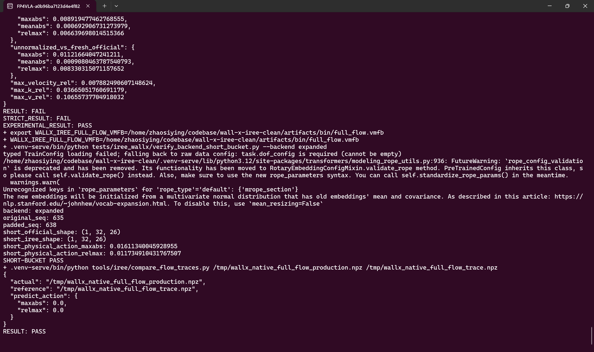

**关键原生日志节选：`implementation_evidence/native_logs/full_flow_verify.console.log`（完整文件 21869 bytes，随 evidence 保存）**

```text
The new embeddings will be initialized from a multivariate normal distribution that has old embeddings' mean and covariance. As described in this article: https://nlp.stanford.edu/~johnhew/vocab-expansion.html. To disable this, use `mean_resizing=False`
{
  "mode": "production",
  "predict_shape": [
    1,
    32,
    26
  ],
  "session_calls": 1,
  "vmfb": "/home/zhaosiying/codebase/wall-x-iree-clean/artifacts/bin/full_flow.vmfb",
  "pytorch_vision_calls": 0,
  "pytorch_action_step_calls": 0
}
RESULT: PASS
  "final_vs_fresh_official": {
    "maxabs": 0.013089805841445923,
    "meanabs": 0.001052395673468709,
    "relmax": 0.012914887083060513
  },
  "unnormalized_vs_official_bank": {
    "maxabs": 0.008919477462768555,
    "meanabs": 0.000692906731273979,
    "relmax": 0.006639698014515366
  },
  "unnormalized_vs_fresh_official": {
    "maxabs": 0.01121664047241211,
    "meanabs": 0.0009080463787540793,
    "relmax": 0.008330315071157652
  },
  "max_velocity_rel": 0.007882490607148624,
  "max_k_rel": 0.03665051760691179,
  "max_v_rel": 0.10655737704918032
}
RESULT: FAIL
STRICT_RESULT: FAIL
EXPERIMENTAL_RESULT: PASS
backend: expanded
original_seq: 635
padded_seq: 638
short_official_shape: (1, 32, 26)
short_iree_shape: (1, 32, 26)
short_physical_action_maxabs: 0.01611340045928955
short_physical_action_relmax: 0.011734910431767507
SHORT-BUCKET PASS
+ .venv-serve/bin/python tools/iree/compare_flow_traces.py /tmp/wallx_native_full_flow_production.npz /tmp/wallx_native_full_flow_trace.npz
{
  "actual": "/tmp/wallx_native_full_flow_production.npz",
  "reference": "/tmp/wallx_native_full_flow_trace.npz",
  "predict_action": {
    "maxabs": 0.0,
    "relmax": 0.0
  }
}
RESULT: PASS
```
staged IREE 的 resident、官方物理输出、短桶、prefill 和 36 层 suffix 回归也保留关键输出，完整文件随 evidence 保存：

**关键原生日志节选：`implementation_evidence/native_logs/staged_verify.console.log`（完整文件 9224 bytes，随 evidence 保存）**

```text
resident_vs_cli_final_maxabs: 0.0
resident_vs_cli_array_equal: True
RESIDENT-FLOW PASS
physical_action_maxabs: 0.013390183448791504
physical_action_relmax: 0.009967711094069104
BACKEND-OFFICIAL-OUTPUT PASS
{'chain_first6': [0.004808, 0.004673, 0.006494, 0.006452, 0.00641, 0.00641], 'chain_max': 0.006897, 'kv_all_bitwise': False, 'kv_k_first3': [0.0, 0.006369, 0.006366], 'v0_maxabs': 0.010728, 'x0_maxabs': 0.001072, 'v0_relmax': 0.00280708}
RESULT: PASS
{'n_layers_cmp': 36, 'layer_maxabs': [0.0, 0.0, 0.0, 0.0, 0.0, 0.0, 0.0, 0.0, 0.0, 0.0, 0.0, 0.0, 0.0, 0.0, 0.0, 0.0, 0.0, 0.0, 0.0, 0.0, 0.0, 0.0, 0.0, 0.0, 0.0, 0.0, 0.0, 0.0, 0.0, 0.0, 0.0, 0.0, 0.0, 0.0, 0.0, 0.0], 'corridor_zero': True, 'final_hidden_maxabs': 0.0, 'v_maxabs': 0.0, 'v_relmax': 0.0}
RESULT: PASS
```
这些输出共同定义当前状态：整图计算与 serving 调用链已经执行，最终动作通过有限门槛，严格验收仍显示 context 与完整 KV 失败。

## 九、原生复现证据：从环境到 backend serving

复现命令和证据文件使用同一路径。所有长任务在 WSL 中串行执行，编译前检查 `free -g`，GPU 任务前确认显存空闲。下面的环境样张和日志来自实际 `feat/iree-serving-backend` worktree：

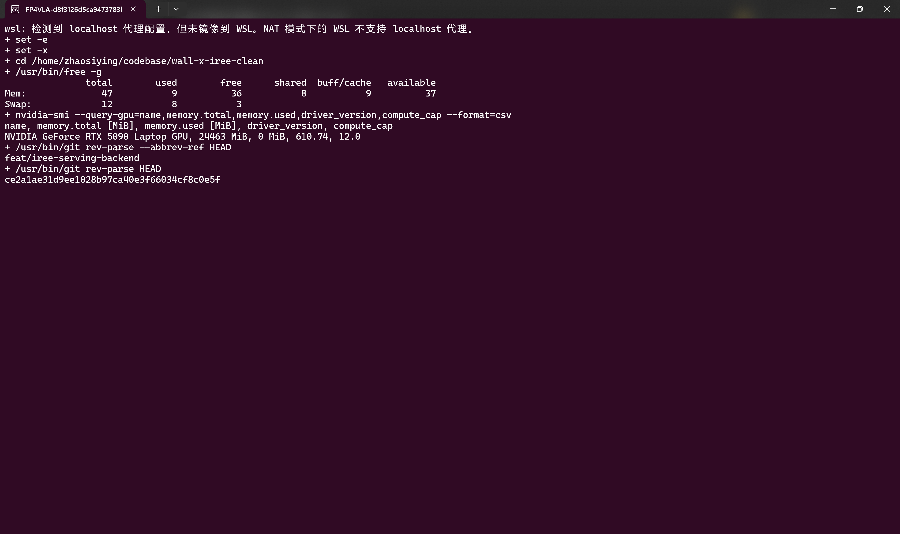

**关键原生日志节选：`implementation_evidence/native_logs/environment.console.log`（完整文件 668 bytes，随 evidence 保存）**

```text
+ set -e
+ set -x
+ cd /home/zhaosiying/codebase/wall-x-iree-clean
+ /usr/bin/free -g
               total        used        free      shared  buff/cache   available
Mem:              47           9          36           8           9          37
Swap:             12           8           3
+ nvidia-smi --query-gpu=name,memory.total,memory.used,driver_version,compute_cap --format=csv
name, memory.total [MiB], memory.used [MiB], driver_version, compute_cap
NVIDIA GeForce RTX 5090 Laptop GPU, 24463 MiB, 0 MiB, 610.74, 12.0
+ /usr/bin/git rev-parse --abbrev-ref HEAD
feat/iree-serving-backend
+ /usr/bin/git rev-parse HEAD
ce2a1ae31d9ee1028b97ca40e3f66034cf8c0e5f
```
### 9.1 权重与冻结 bank

```bash
cd ~/codebase/wall-x-iree-clean
export PYTHONPATH="$PWD"
export LD_LIBRARY_PATH="$PWD/build/cudalib:${LD_LIBRARY_PATH:-}"
export WALLX_CKPT="$HOME/codebase/weights/wall-oss-0.5"
printf '%s  %s\n' \
  '37f8f327d3f9c27f056ed078db43c0e39b8caf3df0dc0163cdb8cf92c167968a' \
  "$WALLX_CKPT/model.safetensors" | sha256sum -c -
sha256sum "$WALLX_CKPT/model.safetensors" > /tmp/wallx_checkpoint_sha256.txt
.venv-serve/bin/python tools/manifest/build_model_manifest.py \
  --checkpoint "$WALLX_CKPT" \
  --output artifacts/manifests/model.json \
  --model-hash-from /tmp/wallx_checkpoint_sha256.txt
.venv-serve/bin/python tools/manifest/build_bank.py \
  --checkpoint "$WALLX_CKPT" --samples 4
```

这四个 `.pt` 文件是**冻结的推理测试输入包**，由 `tools/manifest/build_bank.py` 使用官方模型和 `NOISE_SEED=20261023` 生成。它们不是训练集，也不是模型权重；`full_flow.weights.irpa` 才保存模型权重。每个文件约 13 MB，包含原始观测、预处理后的图像 patch、token/mask、显式 noise、完整 ctx、postfix、每层 K/V 摘要、`v0`、Flow 轨迹和最终动作。`index.json` 另存时间网格、路由和 mRoPE 的结构校验及样本哈希。

| 文件 | 指令 | 序列长度 | 在验证中的用途 |
|---|---|---:|---|
| `sample_000.pt` | `pick up the object` | 638 | 整图导出示例、逐层对拍和性能基准 |
| `sample_001.pt` | `put the cup on the plate` | 638 | 同 bucket 下的另一条输入，检查指令变化 |
| `sample_002.pt` | `open the drawer and take out the towel` | 633 | 短输入：prefix 601 + action 32，用于左 padding 检查 |
| `sample_003.pt` | `fold the cloth and place it on the shelf` | 641 | 超过 638 bucket，要求新 bucket 或明确拒绝 |

冻结这些输入后，官方 eager、`torch.compile` 和 IREE 可以共享同一份初始随机场和 metadata，逐层比较 context、K/V、速度、轨迹和最终动作。`sample_002` 的 633 与真实短桶测试使用的 635 不是同一个样本，后者来自另一条 serving 输入。bank 和模型 artifact 均不纳入 Git；需要时按上面的命令从 checkpoint 重新生成。

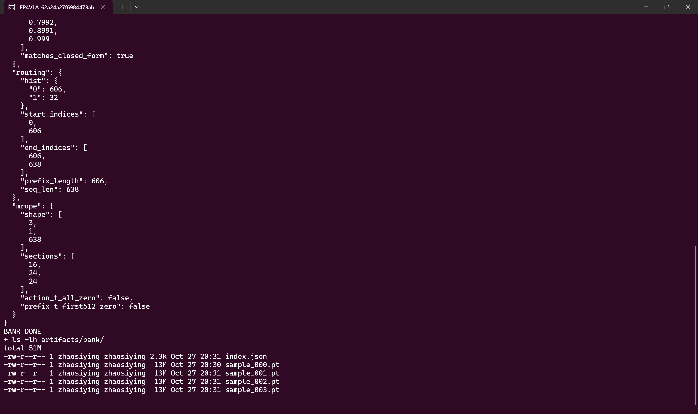

**关键原生日志节选：`implementation_evidence/native_logs/weights.console.log`（完整文件 4420 bytes，随 evidence 保存）**

```text
+ printf '%s  %s\n' 37f8f327d3f9c27f056ed078db43c0e39b8caf3df0dc0163cdb8cf92c167968a /home/zhaosiying/codebase/wallx-jax/weights/wall-oss-0.5/model.safetensors
+ sha256sum -c -
/home/zhaosiying/codebase/wallx-jax/weights/wall-oss-0.5/model.safetensors: OK
+ sha256sum /home/zhaosiying/codebase/wallx-jax/weights/wall-oss-0.5/model.safetensors
+ .venv-serve/bin/python tools/manifest/build_model_manifest.py --checkpoint /home/zhaosiying/codebase/wallx-jax/weights/wall-oss-0.5 --output artifacts/manifests/model.json --model-hash-from /tmp/wallx_native_checkpoint_sha256.txt
+ .venv-serve/bin/python tools/manifest/build_bank.py --checkpoint /home/zhaosiying/codebase/wallx-jax/weights/wall-oss-0.5 --samples 4
sample 0: saved sample_000.pt (13.1 MB)
sample 1: saved sample_001.pt (13.1 MB)
sample 2: saved sample_002.pt (13.1 MB)
sample 3: saved sample_003.pt (13.2 MB)
  "time_grid_note": "time_shift resolved from noise_scheduler config with default 1.0; beta_alpha=1.5, beta_beta=1.0 are not part of the inference grid",
  "time_grid": {
    "N": 10,
    "len": 11,
    "shift": 1.0,
    "s": 0.999,
    "values": [
  "routing": {
    "hist": {
      "0": 606,
      "1": 32
    },
    "start_indices": [
      0,
      606
    ],
    "end_indices": [
      606,
      638
    ],
    "prefix_length": 606,
    "seq_len": 638
BANK DONE
+ ls -lh artifacts/bank/
```
### 9.2 整图导出、编译、验证与 serving

```bash
.venv-serve/bin/python tools/iree/export_full_flow.py --vision-attn eager-bf16
.venv-serve/bin/python tools/iree/export_full_flow.py \
  --trace --skip-params --vision-attn eager-bf16

.venv-serve/bin/iree-compile artifacts/ir/full_flow.mlir \
  --iree-hal-target-device=cuda --iree-cuda-target=sm_120 \
  --dump-compilation-phases-to=/tmp/wallx_full_flow_phases \
  --iree-hal-dump-executable-configurations-to=/tmp/wallx_full_flow_hal \
  --mlir-timing --mlir-pass-statistics --mlir-print-ir-after-failure \
  -o artifacts/bin/full_flow.vmfb
.venv-serve/bin/iree-compile artifacts/ir/full_flow_trace.mlir \
  --iree-hal-target-device=cuda --iree-cuda-target=sm_120 \
  --dump-compilation-phases-to=/tmp/wallx_full_flow_trace_phases \
  --iree-hal-dump-executable-configurations-to=/tmp/wallx_full_flow_trace_hal \
  --mlir-timing --mlir-pass-statistics --mlir-print-ir-after-failure \
  -o artifacts/bin/full_flow_trace.vmfb

export WALLX_IREE_FULL_FLOW_VMFB="$PWD/artifacts/bin/full_flow.vmfb"
export WALLX_IREE_FULL_FLOW_IRPA="$PWD/artifacts/bin/full_flow.weights.irpa"
export WALLX_IREE_CUDALIB="$PWD/build/cudalib"
.venv-serve/bin/python tests/iree_wallx/verify_full_flow.py \
  --mode production --official-attn eager
.venv-serve/bin/python tests/iree_wallx/verify_full_flow.py \
  --mode trace --official-attn eager --fresh-official-flow \
  --allow-experimental --vmfb "$PWD/artifacts/bin/full_flow_trace.vmfb"

PYTHON_BIN="$PWD/.venv-serve/bin/python" \
SERVER_LOG=/tmp/wallx_expanded_server.log WS_PRINT_RESPONSE=1 \
  bash scripts/iree_serving.sh expanded_serve
```

### 9.3 证据文件索引

| 文件 | 原生内容 | 对应结论 |
|---|---|---|
| `full_flow_export.console.log` | Turbine 生产/trace 导出、MLIR/IRPA 大小与哈希 | 整图导出契约 |
| `full_flow_iree_compile.console.log` | 24,697 行 IREE pass statistics 与 timing | MLIR/Pass 和设备编译 |
| `expanded_serving.console.log` | 真实后端激活、服务器输出、完整动作响应 | serving 与动作 ABI |
| `full_flow_verify.console.log` | context/KV/轨迹/最终动作及严格 verdict | 数值验收边界 |
| `backend_compare.console.log` 与 `results/` | 四后端逐次 wall time、JSON、动作数组 | 同边界性能与数值比较 |
| `capture_provenance/` | 窗口绑定、裁剪与执行元数据 | 截图来源和完整性 |
| `native_logs/manifest.json` | 全部日志、结果文件和终端图片的字节数与 SHA-256 | 证据完整性复核 |

HTML 中的日志块保留全文，终端截图记录同一次执行的原生画面。截图只裁掉 Windows 任务栏，终端内容和输出顺序保持原样。

## 十、性能：torch.compile 强基线、当前差距与追平路线

### 10.1 先固定三种测量边界

性能数字按边界分别解释：

1. **设备驻留 solver**：embedding、位置、mask、noise 和 postfix 已预先构造，计时覆盖 prefill、9 次 denoise 与 Euler，输出设备上的归一化动作。
2. **generate-call / Model API spot**：模型输入和 session 在计时前完成初始化，计时覆盖 context、Flow 和官方 finalizer，最终 `detach().cpu().numpy()` 不计入。
3. **完整 serving / WebSocket**：进一步包含首次加载、观测协议、服务器调度和网络往返。首次请求 `infer_ms` 不属于稳态数字。

不同边界、注意力实现、代码版本和样本协议不合并成一个加速比。

### 10.2 同 generate-call 的四后端实测

当前实现提供真实的 `torch-compile` backend，因而可以在同一 `generate_flow_action` 入口下比较。每个后端进程执行 3 次 warmup 和 10 次计时，共两轮；第二轮反转后端顺序。每个后端 pooled 20 个样本，使用同一显式 noise、输入、同步和 finalizer。

| 后端 | 实现/profile | pooled n | median | mean | p95 |
|---|---|---:|---:|---:|---:|
| 官方 eager | 官方模型路径 | 20 | 578.051 ms | 601.468 ms | 766.026 ms |
| `torch.compile` | static prefill/suffix，reduce-overhead | 20 | **137.290 ms** | 137.502 ms | 140.166 ms |
| staged IREE | Torch context + prefill/step + Host Euler | 20 | 395.439 ms | 395.136 ms | 409.280 ms |
| expanded IREE | eager-BF16 ViT + `full_flow` + 图内 Euler | 20 | 389.720 ms | 392.184 ms | 401.212 ms |

**expanded 与 `torch.compile` 的当前同边界差距为 252.430 ms，median 比值 2.839×。** expanded 略低于 staged 的 median，但仍明显慢于 `torch.compile`。官方 eager 两轮存在顺序波动，因此表中同时保留 mean、median 和 p95，不挑选单轮较低值作为结论。

同轮最终物理动作与官方数组的比较为：

| 后端 | 两轮 relmax | 2% 门槛 |
|---|---:|---|
| `torch.compile` | 1.0730% / 1.0730% | 通过 |
| staged IREE | 0.9968% / 0.9968% | 通过 |
| expanded IREE | 0.6640% / 0.6640% | 通过 |

这些数值检查针对最终动作。expanded 的 context 与 V-cache 严格失败仍在第 8 章保留，严格替代仍需通过这些检查。

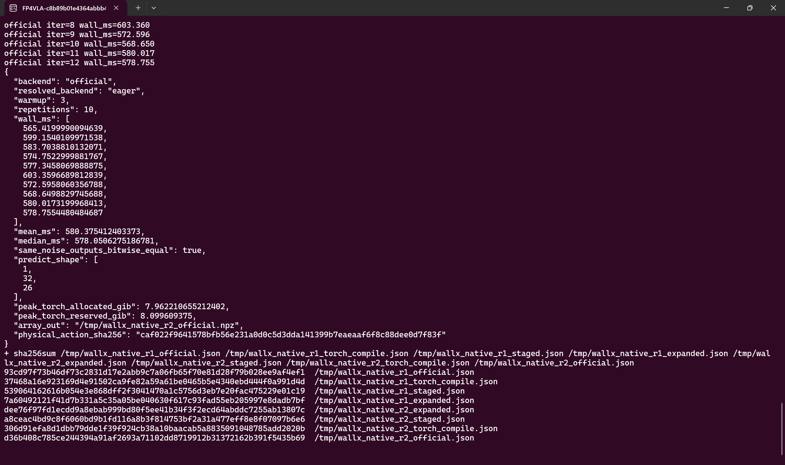

**关键原生日志节选：`implementation_evidence/native_logs/backend_compare.console.log`（完整文件 17433 bytes，随 evidence 保存）**

```text
{
  "backend": "official",
  "resolved_backend": "eager",
  "warmup": 3,
  "repetitions": 10,
  "wall_ms": [
    565.4199990094639,
    599.1540109971538,
    583.7038810132071,
    574.7522999881767,
    577.3458069888875,
    603.3596689812839,
    572.5958060356788,
    568.6498829745688,
    580.0173199968413,
    578.7554480484687
  ],
  "mean_ms": 580.375412403373,
  "median_ms": 578.0506275186781,
  "same_noise_outputs_bitwise_equal": true,
  "predict_shape": [
    1,
    32,
    26
  ],
  "peak_torch_allocated_gib": 7.962210655212402,
  "peak_torch_reserved_gib": 8.099609375,
  "array_out": "/tmp/wallx_native_r2_official.npz",
  "physical_action_sha256": "caf022f9641578bfb56e231a0d0c5d3dda141399b7eaeaaf6f8c88dee0d7f83f"
}
{
  "backend": "torch-compile",
  "resolved_backend": "torch-compile",
  "warmup": 3,
  "repetitions": 10,
  "wall_ms": [
    137.6879180315882,
    137.40958395646885,
    136.89190399600193,
    140.03711799159646,
    138.69492203230038,
    136.1138399806805,
    134.89739003125578,
    140.1023860089481,
    137.17033696593717,
    139.11335897864774
  ],
  "mean_ms": 137.8118757973425,
  "median_ms": 137.54875099402852,
  "same_noise_outputs_bitwise_equal": true,
  "predict_shape": [
    1,
    32,
    26
  ],
  "peak_torch_allocated_gib": 7.991147518157959,
  "peak_torch_reserved_gib": 8.232421875,
  "torch_compile_mode": "reduce-overhead",
  "array_out": "/tmp/wallx_native_r2_torch_compile.npz",
  "physical_action_sha256": "61b6af7af469973643b8be4b685ede83204f73290801d46dc54f9cbf27900e80"
}
{
  "backend": "staged",
  "resolved_backend": "iree",
  "warmup": 3,
  "repetitions": 10,
  "wall_ms": [
    397.23240199964494,
    390.11495298473164,
    389.04519396601245,
    395.35464998334646,
    389.1064689960331,
    389.951438002754,
    395.84375702543184,
    388.91234598122537,
    396.45169803407043,
    388.82832502713427
  ],
  "mean_ms": 392.08412320003845,
  "median_ms": 390.0331954937428,
  "same_noise_outputs_bitwise_equal": true,
  "predict_shape": [
    1,
    32,
    26
  ],
  "peak_torch_allocated_gib": 7.932619571685791,
  "peak_torch_reserved_gib": 8.048828125,
  "array_out": "/tmp/wallx_native_r2_staged.npz",
  "physical_action_sha256": "0a208d6ceff85b6c3cd252dff7ea660b5271cbed1e8cf59b805d790f521a920e"
}
{
  "backend": "expanded",
  "resolved_backend": "iree-expanded",
  "warmup": 3,
  "repetitions": 10,
  "wall_ms": [
    385.72539400774986,
    388.18454794818535,
    389.7139619803056,
    387.2200599871576,
    392.64483097940683,
    389.46113898418844,
    385.75217803008854,
    391.2114000413567,
    387.09357799962163,
    388.818136008922
  ],
  "mean_ms": 388.58252259669825,
  "median_ms": 388.5013419785537,
  "same_noise_outputs_bitwise_equal": true,
  "predict_shape": [
    1,
    32,
    26
  ],
  "peak_torch_allocated_gib": 7.872530460357666,
  "peak_torch_reserved_gib": 7.962890625,
  "array_out": "/tmp/wallx_native_r2_expanded.npz",
  "physical_action_sha256": "bb6a982bca3f21cf25b1be9e0250db08c20419441761647deedeba3e4b5941a5"
}
```
八个逐次结果 JSON 和对应动作数组位于 `implementation_evidence/native_logs/results/`，聚合统计位于 `native_backend_comparison.json`。读者可以独立重新计算上表。

### 10.3 B3/B4 solver 强基线仍然保留

既有设备驻留 solver 基准在相同输入上比较静态 eager、B4 默认 Inductor 和 B3 reduce-overhead。B4/B3 分别编译 prefill 与 step，计时包含 Python 九步循环、Euler 和必要的输出 clone，但排除 ViT/context、finalizer 和 Host 输出。

| 后端 | solver 边界 | 样本 | p50 | mean |
|---|---|---:|---:|---:|
| 静态 eager | 设备驻留 solver | 15 | 345.1 ms | 344.9 ms |
| B4：默认 `torch.compile` | 设备驻留 solver | 15 | 115.1 ms | 115.6 ms |
| B3：`torch.compile(mode="reduce-overhead")` | 设备驻留 solver | 15 | **87.5 ms** | 87.4 ms |
| B3 正式 P8 | 设备驻留 solver | 5000 | **88.88 ms** | 88.98 ms |

原始记录保存在 `b3_b4_baselines.json` 和 `p8_b3_summary.json`。B3 的 solver-only 88.88 ms 与上表 expanded 的 generate-call 389.720 ms 属于不同工作范围，两个结果分别保留各自边界，不计算跨边界比值。当前 `torch.compile` 在同一 generate-call 下的 137.290 ms 才是与 expanded 可直接讨论的对照。

### 10.4 追平 `torch.compile` 还需要的工作

当前 252.430 ms 差距需要先分项测量，再决定优化顺序。后续工作按以下约束推进：

1. **先解决严格数值门。** context 6.12648% 与 max V 10.65574% 仍阻止 expanded 成为严格替代。任何 dtype、attention 或融合修改都同步复核 context、K/V、速度、轨迹和最终动作。
2. **建立 expanded 分项延迟预算。** 分别测量 ViT/context、joint prefill、九次 suffix/Euler、metadata/mask、主机传输和 finalizer。只有知道各阶段占比，才能把 252.430 ms 分配给真实原因。
3. **消除主机往返与重复同步。** 当前 expanded 将 GPU 输入转为 NumPy，再复制到 IREE Device，最终动作也经过 D2H 后转回 GPU 反归一化。优先实现设备 buffer 输入、静态 buffer 预绑定、输出设备驻留和可验证的 metadata 缓存。
4. **优化静态 ViT。** 针对 32 个 64-token window 和两个 1024-token full-attention segment，优化 QK、FP32 softmax、PV 与相邻 reshape/transpose 的调度。 fused attention 必须保持 eager-BF16 的运算顺序和舍入点，并重新通过数值门。
5. **对齐 Inductor 的融合和内存行为。** 对照 B3 的 Triton kernel、fusion group、tile、warp/stage 与内存访问，审查 IREE dispatch：减少 GQA `repeat_kv`、head-expanded mask、zero-corridor zeros/cat 和重复物化，融合 norm、RoPE、cast、gated residual 与 Euler 链。
6. **补齐两类同边界基准。** 完整张量图基准比较同一十输入 ABI 下的 eager、B4、B3 与 IREE `full_flow`；solver-only 基准排除 ViT/context，与既有 B3/B4 的输入输出完全一致。独立进程、交错轮次、相同轮换 noise，并分别记录冷启动、稳态、数值误差和 artifact hash。

论文中关于 CUDA Graph 和自定义融合 kernel 的讨论可作为分解 launch 空泡与中间物化的参考（Wall-OSS-0.5 §2.3，p.7–8），那些结果属于作者的原生实现，当前 IREE 的收益以本文实测为准。

## 十一、当前边界、源码索引与新增模型的接入顺序

当前部署链具有以下边界：

- `iree-expanded` 保持 experimental-only：一次 VMFB 调用和最终动作门槛成立，context 6.1265% 与 max V 10.6557% 超过严格门槛。
- expanded 与同 generate-call `torch.compile` 的 median 差距为 252.430 ms，后续优化必须先完成分项预算，当前差距为 252.430 ms。
- 可张量化的视觉、上下文、Transformer 和 Euler 已进入 `full_flow`；JPEG、tokenizer、mask/position 构造、最终反归一化和协议由 Host 承担。
- 638 是当前验证的静态桶，进入图时的 prefix 必须为 606；更长序列、其他 prefix、动态 batch、视频和其他图像网格需要对应导出与验收。
- 严格视觉对齐使用官方 eager profile；FlashAttention2 与 SDPA 作为独立对照配置分别测量。
- GPU-core solver、generate-call、完整 predict、server 和 WebSocket RTT 分别报告，首次加载与稳态执行分开。

核心源码入口：

| 文件 | 作用 |
|---|---|
| `wall_x/serving/backend/base.py` | 共同 flow-action backend 接口 |
| `wall_x/serving/backend/registry.py` | lazy registry、alias、显式 artifact 与失败语义 |
| `wall_x/serving/backend/eager.py` | 官方 eager 后端 |
| `wall_x/serving/backend/wallx_flow.py` | 官方 context、bucket、mask、noise 与 finalizer |
| `wall_x/serving/backend/torch_compile.py` | `torch.compile` prefill/suffix 与 clone 边界 |
| `wall_x/serving/backend/static_flow/prefill.py` | 双段 prefill、mRoPE、attention、首次 Euler 状态 |
| `wall_x/serving/backend/static_flow/suffix.py` | suffix 速度、KV ABI、DOF padding velocity |
| `wall_x/serving/backend/static_flow/vision.py` | ViT、文本/状态上下文、ordered scatter |
| `wall_x/serving/backend/static_flow/euler.py` | 图内 9 次 suffix/Euler；生产与诊断入口 |
| `wall_x/serving/backend/static_flow/full.py` | context、t=0、prefill、solver 的单一计算图 |
| `wall_x/serving/backend/iree/model.py` | staged/expanded IREE 模型适配 |
| `wall_x/serving/backend/iree/runtime.py` | stock IREE resident runtime 与输出约束 |
| `tools/iree/export_full_flow.py` | 十输入 ABI、生产/trace 导出与外置权重 |
| `scripts/iree_serving.sh` | 原生服务器输出、expanded serving 与响应打印 |
| `tests/iree_wallx/spot_backend_latency.py` | 四后端同 generate-call 对照与动作数组 |
| `tests/iree_wallx/verify_full_flow.py` | 整图数值、轨迹与生产边界 |
| `docs/iree_wallx/README.md` | 环境、编译、serving、日志与评测指南 |

新增具身模型或新 embodiment 时，按以下分层顺序修改：

1. **冻结模型契约。** 明确观测、动作 H/D、专家路由、cache、时间网格、归一化和 embodiment 配置。
2. **在 `static_flow` 表达可 trace 计算。** 复用公共 prefill/suffix/Euler，新增模型专属模块时保持静态 shape 和显式状态。
3. **定义导出与 artifact ABI。** 添加薄 export CLI、输入输出 shape、外置权重和生产/trace 分离；通过数值门后再编译 VMFB。
4. **在后端包声明适配。** 将模型专属准备、能力检查和 artifact 配置放入 backend；仅在确有需要时扩展 registry，IREE upstream 保持原样。
5. **接入统一验证与基准。** 同 noise 对拍、短桶/不同 embodiment、生产/trace、真实 serving、完整动作响应和同边界 `torch.compile` 对照必须同时更新。
6. **保留原生日志。** 编译、运行时、数值和性能证据与代码同步提交，使每个后端选择都能回指实际执行。

复现的安全前提保持不变：WSL 中禁用注入式 profiler，大内存/GPU 操作前检查 `free -g`，GPU 任务串行执行。原始命令、日志、动作数组和 artifact 哈希用于把文章结论回指到真实运行记录。
